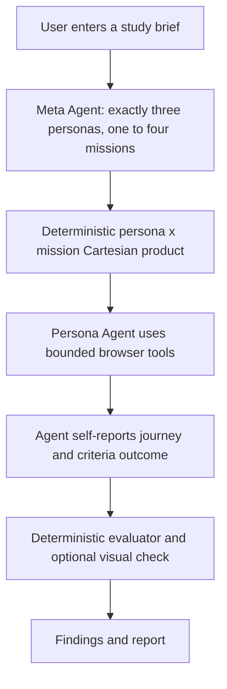
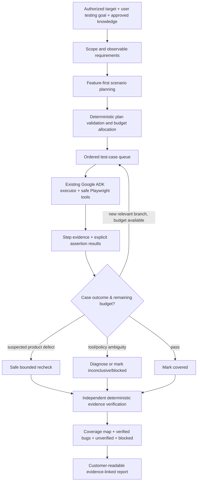
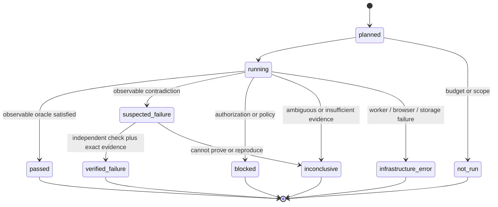
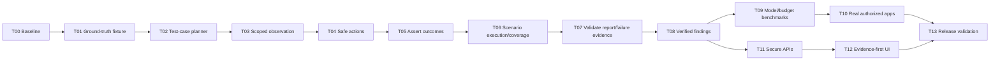

# MarketTwin V1 — Deep Autonomous Testing: Research, Verified Audit, Architecture and Codex Execution Plan

**Prepared:** 2026-10-14  
**Audience:** MarketTwin owner, Codex, and future engineering contributors  
**Product objective:** Make MarketTwin genuinely capable of detailed, accurate, reproducible testing of authorized web application features, **not merely generating plausible persona narratives**.  
**Repository:** [`Sreenav14/Market-Twin`](https://github.com/Sreenav14/Market-Twin)  
**Primary inspected branch:** `feat/batch-1-aws-observability`  
**Verified HEAD of that branch:** `801c2b43aab2a02189217e9e6d5c02773226b0fa`, last committed 2026-10-04  
**Branch check performed 2026-10-14:** GitHub currently lists `main`, `feature/v1`, `refactor/python-browser-controller`, and `feat/batch-1-aws-observability`. The latter is 75 commits ahead of `feature/v1` and 20 commits ahead of `refactor/python-browser-controller`; `main` is not the implemented application branch. **Before editing, check the actual local branch, uncommitted work, and current remote HEAD again.**

> **Direct recommendation:** Do **not** start by copying Perplexity's interface, adding five new LLM agents, replacing Google ADK, or multiplying personas. Build and benchmark **one excellent, bounded, feature-level tester**: explicit scenarios -> real browser execution -> deterministic assertions -> failure diagnosis/recovery -> accurate evidence -> coverage report. Then expand.

> **Scope:** **No interactive human-in-the-loop; no deployment/AWS work in this plan.** Preserve existing target authorization, network restrictions, knowledge approval, login/password/OTP/CAPTCHA protections, persistence, Kafka/outbox, and local Playwright runtime. Do not silently claim that protected/paid/destructive journeys were tested. No code has been modified in GitHub to produce this document.

---

## 0. How to use this document with Codex without burning tokens

1. Copy this file to the **repo root** under the same name and keep it in version control only when you approve.
2. Give Codex the **short kickoff prompt in Section 17**. Tell it to read `AGENTS.md` and **only the current numbered work package** in Section 10; the full document is the reference, not instructions to implement everything in one gigantic diff.
3. Codex must produce one small, testable change at a time, run targeted tests, and stop at the task's gate. Progressing through the whole plan in one prompt is **not** the desired workflow.
4. Codex must inspect current code and tests before touching a file. If this plan conflicts with newer code, **show the discrepancy and use the newer verified code** rather than blindly overwriting it.
5. **Absolutely do not mark a stage done because an LLM summary looks good or a mocked UI test passes.** Evidence from real controlled browser runs is the arbiter.
6. Do not run autonomous tests on public third-party sites without explicit authorization. Use a local fixture with the repo's explicitly supported `local_development` network policy for engineering tests, never by weakening public-site protections.
7. Prefer **surgical additions**, using existing Pydantic models, `RunEvent`, `ExecutionStep`, `Artifact`, and existing APIs. Any database schema migration must be separately justified and backwards-compatible.
8. At the end of every task return exactly: `Files changed`, `Why`, `Tests run / outcome`, `Actual result`, `Unresolved risks`, `Next task`; under 250 words unless troubleshooting requires more.

### Repository instructions are binding

`AGENTS.md` says: think before coding, challenge assumptions, use the simplest possible solution, make surgical changes, and validate explicit success criteria. Do not introduce speculative abstractions or unrelated refactoring.

### Source-evidence labels used below

- **[CODE VERIFIED]** Directly read from the pushed branch and named source files, but **not measured** in a live end-to-end run.
- **[RESEARCH]** Supported by linked external official technical or testing guidance.
- **[HYPOTHESIS]** Reasonable explanation for shallow agents, requiring instrumented runs to confirm.
- **[PROPOSAL]** Specific implementation choice for MarketTwin, not an existing implementation or measured improvement.
- **[UNKNOWN]** Requires access to local runtime, persisted TestRuns, actual model calls, screenshots, traces, fixture environment, or a user study.

**Audit limitation:** I inspected remote source and branch metadata. I did **not** run the user's local app, retrieve their DB records or production logs, inspect unpushed Codex changes, or complete a controlled benchmark. The performance goals in this document are **future acceptance thresholds, not current scores**.

---

## 1. What problem we are actually solving

### 1.1 The failure mode

Today the pipeline is approximately:



**[CODE VERIFIED]** `create_meta_agent()` requires exactly three personas and 1–4 missions. `build_persona_journeys()` combines **every** persona and mission; `execute_multi_persona_plan()` runs them **sequentially**. `create_persona_agent()` prompts the model as a simulated user, not as a comprehensive test designer. `execute_persona_journey()` validates the final JSON schema but does not itself independently prove each claimed criterion. `evaluate_completed_run()` turns agent outcomes into findings and can attach the last screenshot from that execution rather than the step proving the claim.

This architecture is capable of **testing a narrow user journey**. It has no explicit contract ensuring a feature gets positive, invalid-input, boundary, state-transition, error-recovery, keyboard, responsive, and documented-business-rule coverage. **Three perspectives are not three comprehensive test suites.**

### 1.2 The product MarketTwin should deliver

For one authorized feature, a nontechnical user provides a goal, optionally approved knowledge, and a target. MarketTwin then:

1. **Discovers** the relevant visible feature and its known requirements, without claiming exhaustive knowledge of the whole website.
2. **Plans explicit test cases** (ordinary success, negative, boundary, recovery, and relevant behavior variations) with a verifiable expected result for each.
3. **Executes** real browser actions using safe, resilient, scoped locators.
4. **Asserts** whether each expected result was observed. A successful click alone is never enough.
5. **Recovers** from transient locator/navigation problems when safe; stops and records limits when blocked.
6. **Investigates** surprising states with a tightly capped additional step/time budget.
7. **Rechecks** suspected application bugs if safe and reproducible, but never repeats unsafe destructive actions.
8. **Reports** passed, failed, blocked, inconclusive, and not-run cases; every confirmed bug has exact provenance.

**Testing depth ≠ longer prose, more personas, or a larger model alone.** Depth means relevant test design + interactions + trustworthy checks + coverage accounting.

### 1.3 Supported V1 boundary

- Public or otherwise explicitly authorized, low-risk UI flows; no automated credential, OTP, CAPTCHA, payment or destructive operations.
- Positive/negative/boundary form validation, navigation, common UI state transitions, read-only displays, search/filter/sort, safe non-destructive submissions on controlled fixtures, keyboard checks where technically supported, and targeted visual checks.
- Approved, source-grounded business requirements where selected; exploratory checks without those sources should be marked as inferred expectations.
- Do **not** promise full accessibility certification, security penetration testing, production performance/load testing, payment completion, authenticated business workflows requiring human help, or real-user sentiment.
- Never infer customer adoption, conversion, loyalty, or happiness from three synthetic personas.

---

## 2. Double-checked repository inventory and confirmed limitations

| Component | Exact file / symbol | Current behavior | Effect on testing depth | Evidence level |
|---|---|---|---|---|
| Meta planner | `services/execution-orchestrator/src/markettwin_execution_orchestrator/agents/meta_agent.py` / `create_meta_agent` | 3 personas; 1–4 missions; mission observable criteria; `META_AGENT_MAX_TOKENS=1024` | Emphasizes persona diversity over systematic scenario classes | CODE VERIFIED |
| Plan contract | `.../agents/schemas/plan.py` / `MetaAgentPlan` | `personas: tuple` of exactly 3, `missions` of 1–4 | No structured list of deep feature test cases | CODE VERIFIED |
| Mission contract | `.../agents/schemas/mission.py` / `TestMissionSpec` | name, objective, 1–8 criteria, priority | No explicit preconditions, input partitions, safe data, assertion oracle, coverage kind | CODE VERIFIED |
| Persona contract | `.../agents/schemas/persona.py` | perspective, traits, priorities | Can vary behavior, but not a test-design specification | CODE VERIFIED |
| Journey expansion | `.../workflow/journey_planner.py` / `build_persona_journeys` | All persona–mission combinations | Wasteful repeated flows; no risk-based selection | CODE VERIFIED |
| Executor | `.../workflow/multi_persona_executor.py` / `execute_multi_persona_plan` | Sequential journey execution | No adaptive breadth/depth controller or shared coverage accounting | CODE VERIFIED |
| Run orchestration | `.../workflow/run_executor.py` / `execute_markettwin_run` | Planning -> persisted plan -> sequential execution -> completed | Keep lifecycle and persistence; add capabilities incrementally | CODE VERIFIED |
| Persisted-run budget | `.../workflow/run_request.py` / `build_run_request` | Default **90 seconds per journey** | Can constrain multi-screen or diagnostic flows | CODE VERIFIED; contribution to failures UNKNOWN |
| Executor class default | `.../workflow/journey_executor.py` / `PersonaJourneyExecutionRequest` | Default **180 seconds**, overridden by persisted request | Do not confuse effective worker 90s with class default | CODE VERIFIED |
| Persona agent | `.../agents/persona_agents.py` / `create_persona_agent` | Simulated user, browser tools, final JSON | Instructions don't require systematic positive/negative/boundary cases | CODE VERIFIED |
| Model provider | `.../models/model_factory.py` | Default `openai/gpt-4o-mini`; `DEFAULT_MAX_TOKENS=512` (persona uses default) | May constrain long structured output; measure instead of guessing | CODE VERIFIED / HYPOTHESIS |
| Browser authority | `.../browser/controller.py` / `BrowserController` | Python Playwright, fresh Chromium browser/context per journey, request/network policy, per-session lock, captures | Keep; do not replace with Playwright MCP | CODE VERIFIED |
| Browser tools | `.../browser/tools.py` / `create_browser_tools` | `get_state`, `navigate`, `click`, `fill`, `select`, `scroll`, `go_back`, `wait`, `capture_element`, `take_screenshot` | Missing bounded keyboard, check/uncheck, scoped search, explicit assertions, failure diagnosis features | CODE VERIFIED |
| Locator helper | `.../browser/actions.py` / `semantic_locator` | Exactly one of role+name / label / text, exact matching | Ambiguous/repeated controls in lists/forms hard to target | CODE VERIFIED |
| Observation | `.../browser/observations.py` / `build_observation` | Max 80 viewport elements, derived semantic labels, viewport metrics, ARIA, errors | Scanning, repeated controls, long dynamic pages may exceed context | CODE VERIFIED / HYPOTHESIS |
| Context return | `.../browser/contracts.py` / `BrowserObservation.to_dict` | ARIA text truncated to **2,000 chars** for model; full snapshot can be saved | Model may miss relevant context on long pages | CODE VERIFIED / HYPOTHESIS |
| Screenshot reasoning | `.../agents/persona_agents.py` + `.../evaluation-worker/.../visual_verifier.py` | Agent explicitly cannot infer pixels from a screenshot *path*; separate visual VLM sees real pixels in evaluation | Agent may be blind to layout before deciding what to do | CODE VERIFIED |
| Report contract | `.../agents/schemas/persona_report.py` / `PersonaAgentReport` | Outcome, actions, criteria, `criterion_evidence` | Pydantic typing does not verify evidence IDs, assignment or claim truth | CODE VERIFIED |
| Execution recording | `.../persistence/step_recorder.py` / `ExecutionStepRecorder` | Persists steps and screenshots/ARIA artifacts | Strong foundation; use it rather than invent a new browser log | CODE VERIFIED |
| Failed-action recording | `.../browser/tools.py` / `execute_recorded_action` | `BrowserActionError` records failure and returns recovery instructions; no normal evidence recording on exception | Failure-step screenshot can be absent | CODE VERIFIED |
| Deterministic evaluator | `services/evaluation-worker/src/markettwin_evaluation_worker/deterministic_evaluator.py` | Failed/partial agent journeys become findings; multiple reported unmet criteria aggregated | Product bug counts can reflect unverified agent judgments | CODE VERIFIED |
| Evidence selector | `.../persistence/evaluation_repository.py` / `find_preferred_evidence` | Latest screenshot in **same execution**, then trace, then latest step | Real evidence but can be irrelevant to particular claim | CODE VERIFIED |
| Visual verifier | `.../visual_batch_evaluator.py`, `.../visual_verifier.py`, `.../visual_findings.py` | Explicit visual criteria can be verified against image pixels and exact artifact IDs | Retain and extend selectively; **not** proof for all semantic criteria | CODE VERIFIED |
| Report generation | `.../report_generator.py` | Aggregate count/severity, calls findings evidence-backed | Conflates finding existence with proof strength | CODE VERIFIED |
| Run UI | `apps/web/src/layouts/RunLayout.tsx`, `.../pages/runs/*` | Overview/Findings/Report functional; detailed Journey/Evidence pages placeholder | User cannot inspect detailed coverage or actual steps | CODE VERIFIED |
| Control API | `services/control-api/src/markettwin_control_api/api/test_run_results.py`, `api/artifacts.py` | User-scoped report/findings and short-lived artifact access | No public ordered journey-step response for UI | CODE VERIFIED |
| Browser UI tests | `apps/web/e2e/ui-workflow.spec.ts` | Playwright E2E with intercepted `/api/v1/**` | UI tests **do not** validate real backend or agent quality | CODE VERIFIED |

### Additional architectural facts worth preserving

- **Source knowledge:** selected approved knowledge is frozen into TestRun configuration and passed to `MetaPlanningRequest.knowledge_context` by `build_run_request()`; `build_planning_prompt()` includes approved knowledge in planner context. **Persona Agents are not given that full context directly.** See `tests/test_knowledge_planning.py`.
- **Authorization:** target creation/authorization exists; network policy supports `public_only` and an explicit `local_development` setting in browser contracts. Do not let agents alter it via prompts.
- **Session isolation:** `BrowserController.create_session()` constructs a new browser/context for **each journey**; preserve this. Within a case, use the same context across its steps to maintain real UI state. A new context for every click would be wrong.
- **Evidence data:** `ExecutionStep` is keyed by execution and sequence; `Artifact` links by `execution_id` plus optional `step_id`. `Artifact` **does not have `journey_id`**, contrary to a prior research draft. Reach the journey through `AgentExecution -> PersonaJourney`.
- **DB finding lifecycle:** `Finding.status` currently means `open|resolved|dismissed`, **not** evidence verification. A separate verified/unverified concept is needed; do not overload `status` or `severity`.
- **Latest screenshot subtlety:** it is **latest per execution**, not necessarily latest across all runs. The bug is wrong **step relevance**, not necessarily cross-run ownership. Both must still be checked.
- **UI evidence:** `FindingDetailPage.tsx` **already can display an image** after using `api.getArtifactAccess()`. The missing part is directly navigable, ordered steps and truthfully associated proof; do not claim it has no image display at all.
- **Diagnostics:** `scripts/check_latest_test_run_planning.py` **calls the model again** and persists a new runtime snapshot; it is not a read-only view of the original run, and it omits previously selected knowledge context. Prefer persisted plan tables/events for retrospective analysis.

### Explicit corrections to earlier research material

**Do not repeat these inaccuracies in code or planning:**

1. No Playwright MCP is on the **active agent execution path**; it uses Python Playwright. No Cypress E2E suite was found; the frontend uses Playwright.
2. `Artifact` is joined to journeys via execution, not a direct `Artifact.journey_id` column.
3. `FindingEvidence` stores *either* a step reference *or* artifact reference per row; do not assume both are one row.
4. Current API uses authenticated cookie sessions and UUID identifiers; do **not** invent `Authorization: Bearer <token>` or numeric journey IDs as though existing contracts.
5. The final structured Persona report **already exists**. The improvement is to add **test-case coverage and independent verification**, not replace an allegedly free-form output.
6. Snapshot images are actually captured; **the persona has a screenshot path, not necessarily the pixels**. The separate visual verifier does receive image pixels.
7. Two different journey-duration defaults exist: persisted worker 90s and executor request 180s. The effective value needs to be observed in runtime configuration.
8. UI and unit checks do not prove actual agent performance. No real measured accuracy, false-positive rate, or persona diversity score was available.

---

## 3. External research and evidence-based design principles

The following are principles drawn from official documentation, **not proof that MarketTwin implements them**.

1. **Observable outcomes over click counts — Playwright Best Practices.** Tests should verify user-visible behavior, prioritize user-facing locators, and isolate independent scenarios. This supports a scenario -> action -> **observable assertion** loop, rather than a click -> narrative loop. **[RESEARCH]** https://playwright.dev/docs/best-practices
2. **Actionability and auto-waiting — Playwright Python.** Playwright checks visibility, stability, event reachability and enabled/editable state and automatically waits for conditions. Its auto-retrying assertions are superior to unconditional sleeps for state changes. Use Playwright's mechanisms; don't reinvent unreliable polling. **[RESEARCH]** https://playwright.dev/python/docs/actionability and https://playwright.dev/python/docs/locators
3. **Scoping identical controls — Playwright Python Locators.** When multiple `Add to cart` or `Edit` buttons exist, chaining/scoping by a containing list item, dialog, or named region avoids ambiguous global locators. Add a constrained version of this to MarketTwin, not raw arbitrary JS/CSS. **[RESEARCH]** https://playwright.dev/python/docs/locators
4. **Systematic black-box design — ISTQB CTFL v4.0.1.** Equivalence partitioning, boundary-value analysis, decision tables, and state-transition testing are established techniques. Choose relevant techniques per feature; never mechanically apply all of them to every page. **[RESEARCH]** https://astqb.org/assets/documents/ISTQB_CTFL_Syllabus_v4.0.1.pdf
5. **Traces are diagnostic, not verdicts — Playwright Tracing.** Traces capture browser operations and network, but Playwright library-level traces alone do not include Playwright Test assertions. MarketTwin must record its own case/assertion results alongside traces. **[RESEARCH]** https://playwright.dev/docs/api/class-tracing and https://playwright.dev/python/docs/trace-viewer
6. **Agent evaluation must score trajectories — Google ADK ecosystem.** Official guidance supports tool-use quality, multi-turn trajectories, task success, and data-driven eval-fix loops. For MarketTwin, **actual fixture ground truth is still the primary oracle**; optional model graders must not override it. **[RESEARCH]** https://google.github.io/agents-cli/guide/evaluation/
7. **Authentication isolation matters — Playwright.** Persistent browser state can contain private cookies; isolated contexts prevent test bleed. The V1 project intentionally **defers human login** and should not repurpose credentials or silently reuse state. **[RESEARCH]** https://playwright.dev/docs/auth
8. **Security testing requires its own authorized methodology — OWASP WSTG.** Do not label basic UI validation as a full penetration/security assessment; the V1 safe browser toolset is not designed for that. **[RESEARCH]** https://owasp.org/projects/web-security-testing-guide

**Research synthesis:** Use an **explicit coverage model, evidence-producing actions, deterministic assertions, bounded exploration, safe scenario isolation, and a measurable benchmark**. A more detailed prompt by itself is not a sufficient design.

---

## 4. Root-cause diagnosis: code proof vs testable hypotheses

| Suspected reason an agent tests shallowly | Proof in code | What live evidence would confirm or reject it | First action |
|---|---|---|---|
| No systematic test-case planning | Exactly 3 personas and 1–4 broad missions; no case taxonomy | Plan for a form contains no invalid, blank, boundary or recovery scenarios | Add explicit case planning pilot |
| Insufficient execution time | Persisted worker defaults to 90s/case-like journey | Logs show `timed_out`, unfinished states, recurring late cutoff | Instrument elapsed time; test a bounded budget variant |
| Persona output truncated | Default 512 output tokens | Provider `finish_reason=length`, invalid JSON, missing criteria or incomplete final response | Capture safe token/finish metadata; A/B output budget |
| Suppressed/planner reasoning | Agent instructions begin with `/no_think` in Meta/Persona prompts, but provider semantics vary | A/B same-model runs with and without this token show deeper or unchanged exploration | Treat token as provider-specific hypothesis; benchmark removal before retaining it |
| Poor target discovery | First 80 viewport elements and 2,000 ARIA chars model-visible | Target exists in saved ARIA/full DOM but was omitted/truncated; wrong locator | Add scoped observation/search queries |
| Cannot interact with controls | Browser tools lack checkbox/keyboard/scoped controls | Repeated failed click/fill/select and unrecovered missing case | Add smallest missing tool for known fixture |
| No reliable UI assertions | Output chiefly Persona self-report and screenshot-linking | Agent reports `passed` while expected state absent | Add deterministic `assert_state` tool |
| Weak error recovery | Agent prompt says inspect state after failure; tooling emits generic `Click could not be completed` | One simple ambiguous click causes terminal failure | Typed error reasons and bounded retry policy |
| Knowledge not reaching tester | Approved knowledge passed to planner but not explicitly to persona | Agent misses documented rules even though selected knowledge contains them | Bounded, provenance-tagged case context |
| Too many redundant runs | Every persona x mission combination sequentially | Similar steps repeated without additional coverage | Switch to case-first, add coverage-based selection |
| Visual blindness | Persona only gets screenshot paths; later visual verifier reads pixels | Agent fails layout/discoverability while DOM is correct | Targeted VLM observation only for visual cases |
| False bug reporting | Evaluator uses reported outcome and latest screenshot | Finding points at unrelated step/screenshot | Exact evidence association + verifier |
| No feature-specific quality measurement | Existing frontend tests mock backend; no confirmed fixture benchmark | No gold-label comparison or reproducibility metric | Build a fixture + baseline harness first |

**IMPORTANT:** Evidence may show that a factor is not causal. **Do not prescribe replacing the model, increasing every timeout, or adding more agents until the controlled trace confirms the failure type.**

### Failure taxonomy for baseline logs

For each failed case, classify the earliest meaningful cause (multiple contributing causes can be linked): `planning_gap`, `unsupported_browser_action`, `ambiguous_locator`, `stale_observation`, `unobserved_state`, `model_budget_truncation`, `time_budget_exhaustion`, `wrong_expected_oracle`, `app_behavior_defect`, `policy_block`, `authentication_required`, `external_network_failure`, `storage_failure`, `evaluator_error`, `reporting_error`, `unknown`. Keep the raw error internally redacted and the plain-language user diagnosis separate.

---

## 5. Target architecture — roles, not extra LLM workers



**Use existing infrastructure:** FastAPI, Postgres, `RunEvent`, `ExecutionStep`, `Artifact`, signed artifact access, Kafka, Google ADK, Playwright, evaluation worker. **Don't invent another queue, orchestration engine, browser service, or vector database.**

### 5.1 A fundamental change: feature-first, persona-second

**Current:** `3 personas × 1–4 missions = 3–12 journeys` always.

**Proposed incremental path:**

- **Pilot mode (first):** Exactly one specified feature or flow, plus **5–8 concrete scenarios**, ordered by risk. One executor and one isolated browser session **per independent case**, sequentially. Each scenario has a concrete oracle.
- **Once benchmark passes:** Allow a bounded number of features, split by actual user goals, apply risk/coverage ranking, deduplicate repeated scenarios, and use a limited number of personas only where perspective materially changes behavior.
- **Preserve old run mode** during migration for regression comparison. Avoid silently breaking existing historical Run/PersonaJourney records.
- **Non-destructive app state:** New context clears browser session state but **not database-side effects**. Controlled fixture tests need a deterministic data reset or unique seeded records. Do not repeatedly create customer accounts or modify production state.

### 5.2 Why not five LLM agents?

The planning, executing, verifying, prioritizing, and reporting responsibilities are real. But most verification, status transitions, scoping, evidence linkage, budget counting, and coverage aggregation should be **deterministic Python**. A second LLM is justified only for genuinely semantic/visual interpretation where code cannot establish the criterion and should return `unverified` on ambiguity.

### 5.3 Proposed test-case state machine



Never blur **execution state** (`completed` / `timed_out`), **test case verdict** (`passed` / `failed` / `blocked` / `inconclusive`), **finding verification** (`verified` / `unverified`), and **severity** (`info` ... `critical`). These mean different things.

---

## 6. Concrete V1 contracts (proposals, not drop-in code)

Start with Pydantic schemas and a `RunEvent` payload. The examples below are **design contracts**, not code guaranteed to compile unchanged. Codex must inspect existing package boundaries and avoid importing worker-specific modules from unrelated packages.

### 6.1 `FeatureScope`

```json
{
  "feature_key": "registration_form",
  "goal": "Test registration-form validation up to the safe pre-submit stage",
  "starting_url": "https://authorized.example/register",
  "allowed_origins": ["https://authorized.example"],
  "known_requirements": [
    {"id": "req-email", "source": "approved_knowledge", "text": "Email must have a valid format"}
  ],
  "unknown_requirements": ["Whether an account is created after submit"],
  "out_of_scope": ["credential entry", "OTP", "account creation", "payment"],
  "safety_class": "read_only_or_low_risk"
}
```

The `starting_url` is illustrative. Never take such a URL from LLM output without checking the *immutable, user-authorized* origin policy.

### 6.2 `TestCaseSpec` — create in or near the existing agent schema package

```json
{
  "case_id": "registration__invalid_email",
  "feature_key": "registration_form",
  "title": "Invalid email shows an error",
  "kind": "negative",
  "priority": "high",
  "requirement_refs": ["req-email"],
  "preconditions": ["Registration form is displayed"],
  "steps": [
    {"action": "fill", "target": {"label": "Email"}, "test_value_key": "invalid_email"},
    {"action": "blur", "target": {"label": "Email"}}
  ],
  "expected": [
    {"oracle": "visible_text", "target": {"role": "alert"}, "expected_value": "Valid email required"}
  ],
  "safety": "non_destructive",
  "estimated_cost": "low"
}
```

**Key rules:**

- `case_id` stable and unique **within** the run; use explicit IDs rather than matching arbitrary text.
- `kind`: `happy_path | negative | boundary | state_transition | recovery | keyboard | responsive | exploratory | business_rule`.
- `expected` must be user-observable and verifiable; if no reliable oracle exists, mark case **exploratory/unverified**, never a planned guaranteed pass/fail.
- `requirement_refs`: valid approved-knowledge IDs when available; otherwise mark expectation as `inferred`, not product fact.
- `test_value_key` references preapproved non-secret fixture data; don't put random PII or passwords in plans/logs.
- `safety` is enforced **deterministically**; LLM labels never bypass policy.
- No raw shell scripts, arbitrary JS or CSS selectors, internal endpoints, or unrestricted network calls in model-generated cases.
- Validated plan size should be bounded by max cases, max steps, max total time, and max model cost.

### 6.3 `AssertionResult` — the central missing contract

```json
{
  "case_id": "registration__invalid_email",
  "assertion_id": "invalid_email_error_visible",
  "oracle": "visible_text",
  "expected": "Valid email required",
  "observed": "Please enter a valid email address",
  "status": "not_satisfied",
  "step_id": 45,
  "artifact_ids": ["artifact-uuid"],
  "origin": "approved_requirement",
  "reason": "Observed accessible alert text does not match the documented requirement"
}
```

Sample UUID strings above are placeholders; the system must use real UUIDs. At implementation time choose stable machine-readable statuses and distinguish **exact documented text** from acceptable semantic variations. A text mismatch by itself is not a product defect unless the requirement actually demands exact wording.

Supported early deterministic oracles:

- `element_visible` / `element_hidden` — role/name or a **scoped** semantic locator.
- `element_enabled` / `element_disabled`.
- `text_contains` / `text_equals` (only when exact wording documented).
- `url_matches` (authorized origin and bounded match; never compare secret query strings in report).
- `field_value` / `checked_state`.
- `element_count` or selected option value, when the case establishes expected count.
- `navigation_result` based on observed final URL and visible confirmation, not click success.
- `no_page_error` when the case explicitly needs it; network/console noise alone is not necessarily a customer-visible product defect.
- `visual_criterion` only through existing image-pixel verifier and exact artifact IDs.

If an assertion cannot safely inspect expected behavior, result is `unverified`, not a false pass or failure. Use Playwright's auto-wait/retry where appropriate and record the observed value, wait duration, step ID, and failure cause.

### 6.4 `CaseExecutionResult`

```json
{
  "case_id": "registration__invalid_email",
  "execution_id": "uuid",
  "journey_id": "uuid",
  "execution_status": "completed",
  "verdict": "passed",
  "assertion_results": ["stored assertion references"],
  "action_step_ids": [41, 42, 43, 44, 45],
  "blocker_code": null,
  "exploration_notes": [],
  "elapsed_ms": 12843
}
```

**Do not make this a replacement for existing `PersonaAgentReport` immediately.** Add a versioned extension or additional `RunEvent` type, preserve compatibility with already persisted historical runs, and only migrate storage if benchmark needs justify it.

### 6.5 `RunCoverageSummary`

```json
{
  "planned": 7,
  "executed": 6,
  "passed": 3,
  "verified_failed": 1,
  "unverified": 1,
  "blocked": 1,
  "not_run": 1,
  "missing_oracle": 0,
  "requirement_coverage": [
    {"requirement_id": "req-email", "planned_case_ids": ["registration__invalid_email"], "covered_case_ids": ["registration__invalid_email"]}
  ]
}
```

**Coverage does not mean percent of the entire website**. Only report denominator and provenance for cases/requirements known to the run. `covered` should mean that an actual check executed, **not that it passed**. Unknown requirements are excluded from percentage denominators but disclosed as out-of-scope/unknown.

### 6.6 Suggested event additions without first adding tables

Reuse the existing `RunEvent` `event_type` and `payload` for a pilot. Proposed names, to be finalized with current conventions:

- `test_plan.created` — immutable, validated and bounded `FeatureScope` / cases / provenance, **no secrets**.
- `test_case.started` — `case_id`, `journey_id`, `execution_id` and start time.
- `test_case.assertion` — scoped asserted expectation, observed safe summary, status, **exact step and artifact references**.
- `test_case.completed` — verdict, budget consumed, reason and coverage summary.
- `test_case.skipped` — policy/unsupported/budget reason when never executed.
- `test_run.coverage` — final coverage summary and list of unknowns.

**Why start here?** `RunEvent` and execution tables already exist, and early read paths can reconstruct case histories from versioned events. A new relational `test_cases` / `assertions` table may be warranted for query volume and integrity later—but only after a benchmark and UI read requirements confirm the need. Store schema version and validate event payloads; do not treat the JSONB column as untyped chaos.

### 6.7 Verification classification vs ticket status

Do not change `Finding.status=open/resolved/dismissed` to mean confidence. Possible minimal options:

1. **First pilot:** create verified product findings only from assertion-grounded failures and store unverified observations in `RunEvent` / report payload separately. No migration.
2. **Later if needed:** add `verification_state=verified|unverified` and `finding_kind=product_defect|execution_diagnostic|ux_hypothesis` with a compatible DB migration, API contract and tests.

**Preferred first pilot:** Option 1. It keeps confirmed-defect counts trustworthy and reduces schema churn. Preserve cross-persona unmet claims as **unverified diagnostic observations**, linked to their journeys; they cannot be promoted or severity-escalated by repetition alone.


### 6.8 Critical DB compatibility bridge: one persisted Journey per independent test case

**[CODE VERIFIED, checked explicitly after the initial draft]** In `packages/database-python/src/markettwin_database/models/testing.py`, the existing `RunPersona`, `RunMission`, and `PersonaJourney` rows **do not impose** the 3-persona/4-mission Pydantic planner limits. The count limits live in `MetaAgentPlan`, not in those SQLAlchemy tables. `AgentExecution` requires a valid `PersonaJourney` and is unique on `(journey_id, attempt_number)`; `ExecutionStep` and `Artifact` chain through `execution_id`. Existing `PlanRepository.create_from_plan()` only accepts `MetaAgentPlan` and writes its Cartesian product.

**Recommended migration-free pilot mapping:**

- Persist **one** special, clearly labeled `RunPersona` representing the **feature-testing executor role**, not a fake customer. E.g. key `feature_tester_v1`, title `Feature tester`.
- Persist **one `RunMission` per independent `TestCaseSpec`** (6–8 for pilot), using `case_id` as stable mission key inside versioned plan/event metadata, title/objective and assertion descriptions as mission fields.
- Persist **one `PersonaJourney` per case** pointing to that fixed persona and its mission, with unique ordinal and `(test_run_id, persona_id, mission_id)` combination.
- Persist **one `AgentExecution` attempt 1 per `PersonaJourney`**, with a **fresh** Playwright browser context for that case; all case actions/assertions belong to that execution. Reserve attempt 2 for an explicitly safe, recorded recheck, not for normal duplicate coverage.
- Persist `test_plan.created`, `test_case.*`, and existing `journey.result` events scoped to each journey/execution so current evaluation readiness and historic browsing can still locate journeys. The new evaluator path must use **assertion-grounded case events**, not legacy model-reported `outcome`, when validating deep runs.
- Add a small `PlanRepository.create_from_feature_cases(...)` (or equivalently focused helper) that persists the rows and returns IDs with the same transaction/ownership checks as `create_from_plan()`. The deep plan does **not** get passed to `MetaAgentPlan.model_validate()`; otherwise the 3/4 limits wrongly reject it.
- Build the deep-mode runtime using the **existing Google ADK `LlmAgent`, `MetaAgentFactory` patterns, `BrowserController` and recorder** but with **feature-tester instructions**, not the legacy persona instruction saying "you are NOT a generic QA tester." This is a new **mode/role configuration**, not a new infrastructure agent or service.
- Ensure all 6–8 case journeys have `journey.result` even when blocked/not-run if current evaluation readiness depends on each persisted journey having a result. For `not_run` cases, either **do not persist an executable journey** and record plan-only skipped events, or persist an explicit skipped result with compatible lifecycle semantics; inspect existing DB enum constraints before choosing. Do **not** fabricate `completed` browser execution rows for cases never started.

**Why this mapping?** It preserves the repository's existing foreign keys, evidence ownership, API concepts and evaluation flow while making *each test case independently executable and inspectable*. It avoids treating six cases as six "attempts" of one Journey, which would be misleading and conflicts with the current evaluator's latest-event-per-journey behavior. No new schema table is required for the first benchmark.

**Required regression:** a deep-mode run with **one special persona and six case missions** persists six distinct journeys and six distinct executions without violating existing unique constraints; each assertion/artifact resolves through the correct journey; legacy three-persona Cartesian runs remain unchanged. Test a skipped case separately so reporting counts remain correct.

---

## 7. Test design: what “detailed” means in practice

Use **feature-specific cases**, not an indiscriminate checklist. A pricing page without input fields does not require invalid-email tests. A login-protected target without approved auth must stop at the boundary. The case planner should state why a category applies or why it was omitted.

### Example: a controlled registration-form fixture

| Case | Kind | Safe actions | Oracle | Desired verdict |
|---|---|---|---|---|
| Correct email accepted at field level | Happy path | Fill safe synthetic address, blur | No invalid-email error; valid state appears | Pass when observed |
| Empty required field | Negative | Clear field, blur | Required error appears | Pass when observed |
| Invalid email | Negative | Fill `invalid-email`, blur | Invalid format is rejected | Pass when observed |
| Maximum documented input length | Boundary | Enter max / max+1 fixture text if permitted | Behavior matches **documented** bound | Pass/fail/unverified |
| Recover after correction | Recovery | Invalid -> valid input | Prior error clears; form state recovers | Pass when observed |
| Tab navigation | Keyboard | Focus known safe controls and press Tab | Predictable focus movement | Pass/unverified |
| Narrow viewport | Responsive | Set approved preset viewport, inspect relevant controls | Controls usable and present; visual verifier if needed | Pass/unverified |
| Submit would create account | Out of scope | Do **not** submit | Policy prohibits action | Blocked, not bug |

**Critical oracle rule:** "The form refused invalid input" is not always an application defect or validation success until the tester knows *what should happen* and **when** (on blur? on submit? after server response?). The case should specify evidence source: user brief, approved knowledge, observed UX convention (weaker), or explicit fixture truth.

### Scenario selection rules

- Core happy path is usually first because it identifies actual navigation and state transitions.
- Add at least one negative/edge case for relevant interactive controls, not every combination.
- Boundary cases require known input constraints; do not invent 255-character limits.
- Prefer state-transition and recovery tests for dynamic UI over superficial "visited page" checks.
- Check responsive and keyboard behaviors when relevant to feature expectations and supported safe tooling.
- Record all untested, blocked, or unsupported areas with reasons.
- A single tool failure is **not** proof of an app defect; classify and recover only when safe.
- Exploratory investigation must be budgeted and must generate a new case/check record, not an untracked agent digression.

### Coverage gates

- Every case maps to `feature_key`, expected observation, test kind, risk, and source.
- No duplicate case IDs or semantically identical cases without a documented distinct reason.
- Every executed case has at least one recorded outcome check or explicitly `unverified` result.
- `not_run`, `blocked`, `inconclusive` and `verified_failed` have separate counters.
- A case does **not** become "tested" merely because its name appeared in a model answer.

---

## 8. Execution design: make the browser agent actually capable

### 8.1 Planner: first generate verifiable cases, not personality essays

**Where:** `agents/meta_agent.py`, `workflow/planning.py`, new focused schema/helper modules near existing `agents/schemas/`.

**Incremental implementation:** Do not immediately rewrite the legacy `MetaAgentPlan`. Implement a **separately versioned detailed-feature planning path** selected by an explicit internal test-mode flag for the pilot. The existing planner remains a regression baseline. The new path should receive:

- Immutable authorized target origin and user goal.
- Optional approved knowledge with provenance, bounded length and selected relevance.
- Current feature scope; what can be inspected safely.
- Case count/time/step limits; categories to consider when applicable.
- The expected rule that **every test case needs an observable oracle**.
- A declared list of prohibited actions.

For one feature, output candidate cases. Then **Python validates** the schema, unique IDs, source references, safe operations, supported oracle types, budget and duplicates. A planner's invalid result does not silently become a valid test. Use `unverified` or a clearly failed planning state when unrecoverable.

**Planning algorithm proposal:**

1. Derive feature/goal from user-provided brief, do not discover the entire site yet.
2. Build a concise requirement catalog from the user brief and approved knowledge; mark missing requirements unknown.
3. Generate the minimum meaningful happy-path case.
4. Add relevant equivalence partitions, negative inputs, state transitions and error-recovery cases.
5. Add bounded exploratory candidates only where requirements or UI behavior suggest a risk.
6. Validate every case with machine-readable oracle and safe test input.
7. Rank by risk, novelty/coverage, estimated cost and prerequisites. This is a heuristic; **do not invent statistical confidence**.
8. Trim to budget and record skipped cases with reasons.
9. Freeze the accepted plan before execution for reproducibility.

**Do not** use an LLM-generated account password, private phone number, live payment data, or user-secret values. Do not let knowledge documents inject operational instructions: treat them as untrusted source data.

### 8.2 Richer observation — only when requested

**Where:** `browser/observations.py`, `browser/contracts.py`, `browser/controller.py`, `browser/tools.py`.

Existing `browser_get_state()` returns useful state (current URL, title, ARIA, up to 80 elements, viewport geometry, errors, screenshot path) but can be too broad in busy pages and too narrow for a specific task. Instead of unconditionally increasing the 2,000-character limit or sending 100,000 DOM characters:

- Add `browser_find_elements(query)` using **safe role/name/label/text constraints** and bounded results; filter to visible or explicitly queried content.
- Add `browser_get_region(role, name)` or another bounded semantic region-specific snapshot.
- Add `browser_get_form_state(...)` returning safe field labels, type, required, enabled, validation state, messages, available select options, checked flags **without secret values**.
- Give clear `truncated`, `returned_count`, and `more_available` metadata.
- Support deterministic element references or scoped locator descriptors to disambiguate repeated labels; references must be bound to current page/version or explicitly invalidated after navigation.
- Return **post-action state** for click/fill/select when available (already done in success path), and **diagnostic state on failure** when safely capturable.
- Optionally detect tab/dialog/iframe boundaries and report `unsupported` accurately, rather than pretending a target was absent. Implement interactions only after a concrete benchmark case proves necessity.

**Important privacy/security constraint:** HTML, page text, accessibility snapshots, URLs, input values and screenshots can contain sensitive data. Redact or avoid storing credentials, tokens, email/PII where unnecessary. Do not expose raw underlying URL query strings in customer-visible summaries. Bounded read tools must enforce session ownership and network policy; no `eval`, arbitrary JavaScript, filesystem, or unrestricted selectors in model tools.

### 8.3 Add the missing actions **one at a time**

The current agent tools include click, fill, select and navigation, but they lack common interaction semantics. Candidates, ordered by fixture needs:

1. `browser_check` / `browser_uncheck` (visible, safely identified checkbox and radio interaction).
2. `browser_press` (bounded key allowlist such as Tab, Enter, Escape, Arrow keys, Space, Home/End; only after ensuring the action cannot activate unsafe UI elements). Never permit an arbitrary script or OS shortcut.
3. `browser_get_form_state` / targeted `browser_find_elements` (read-only).
4. `browser_assert_state` (read-only deterministic check; see below).
5. `browser_set_viewport` to one of several safe presets for responsive validation, if selected test case requires it.
6. `browser_hover` (menus/tooltips), only when needed.
7. Popup/tab selection if an authorized journey actually needs it; `max_pages_per_session` already exists, but selection behavior must be grounded in controller semantics and origin validation.
8. File uploads, drag/drop, credentials, CAPTCHA and payments are **deferred** (not "missing features" to build automatically).

Every new action must be registered through `create_browser_tools()`, honor the existing per-session/action lock, create a step with `ExecutionStepRecorder`, capture safe evidence, enforce target/action policy, and include unit/integration tests. Keep interactions at a semantic level. **Do not** give an LLM raw Playwright scripting privileges.

### 8.4 Deterministic assertion tool (high leverage)

**Where:** new narrow helper near `browser/controller.py` and tool binding in `browser/tools.py`; results recorded by `ExecutionStepRecorder` and versioned `RunEvent`.

`browser_assert_state` (or a server-side executor check invoked after an action) should:

1. Accept a **whitelisted oracle type**, safe locator, expected value, timeout cap and `case_id`.
2. Validate the oracle is allowed for this test case and target.
3. Resolve semantic locator using Python Playwright, with proper Playwright auto-waiting/retry. Use supported Python async APIs, not JavaScript Playwright imports.
4. Sample/record **actual observed value or absence** and timing.
5. Return `satisfied | not_satisfied | unverified` plus structured diagnostic reason.
6. Associate the result with the **exact assertion step ID**, optional screenshot/log ID, and corresponding case/criterion.
7. Avoid exposing raw sensitive form contents.
8. Never mark a business requirement verified simply because a locator exists; check the actual specified state and timing.

**Pseudocode (semantics only):**

```python
async def assert_visible_text(case_id, selector, expected_text, timeout_ms):
    # Validate preapproved assertion and bounded semantic selector.
    # Get the owned browser session and acquire action lock.
    # Start an ExecutionStep(action_type="assert_visible_text").
    # Use Playwright's retry-friendly locator/expect behavior or equivalent.
    # Observe text/visibility, safely summarize actual state.
    # Persist assertion result + exact execution/step evidence.
    # Return satisfied / not_satisfied / unverified.
    ...
```

**Negative evidence requires care:** A timed-out lookup may mean loading lag, wrong locator, an inaccessible frame, an absent element, or a true product defect. Distinguish these using page readiness, locator diagnostics, known expected state, retry budget and available console/network evidence. `not_satisfied` is an **observation**, while a verified **product defect** requires a reliable requirement and causal connection.

### 8.5 Recovery without false confidence

**Where:** `browser/tools.py`, `browser/controller.py`, `workflow/journey_executor.py`, agent instructions.

Classify recoverable failures:

- Locator ambiguous or missing → inspect scoped state, select the unique visible target; **one or two bounded attempts**.
- Detached/stale element → refresh state; avoid reusing stale references.
- Page still loading → wait for a condition; do not repeatedly sleep blindly.
- Unexpected popup → inspect new page if within authorized origin and supported.
- Safe navigation timeout → inspect current state; retry only if read-only/idempotent and budget remains.
- Action succeeded but expected state absent → **assert failure/investigate**, not reclick automatically.
- Policy-blocked/sensitive/destructive → **stop immediately** with `blocked`.
- Storage, browser or worker error → `infrastructure_error`, not a product defect.

**Bounded loop:** `observe → choose safe action → execute → assert → classify → (recover or exit)`.

**Do not** auto-retry form submissions, delete commands, purchases, account creation or any action with uncertain side effects. A generic text matching `"Pay"` is not a complete safety classification; retain and extend deterministic action validation when new tools are added, and fail closed when uncertain.

### 8.6 Budgets, model parameters and token efficiency

The current `DEFAULT_MAX_TOKENS=512` in `model_factory.py` is directly used by the Persona Agent, while the Meta Agent overrides to 1,024. The persisted run default in `run_request.py` is 90 seconds per journey; `PersonaJourneyExecutionRequest` has a 180-second standalone default.

**Do not globally raise every limit yet.** Also benchmark the literal `/no_think` prefix in `meta_agent.py` and `persona_agents.py`: it may be meaningful for some local models but is not proof of the effective model reasoning mode. Hold all other variables constant when testing this. Add safe observability to report:

- Provider/model name and effective role-specific output budget from existing runtime snapshots.
- Input/output token usage when supported, `finish_reason`, number of tool calls, total elapsed time and per-step elapsed time (avoid storing private model prompts in customer APIs).
- Case completion, assertion count, retry count, and whether a timeout was reached.
- Internal cost estimation by model+tokens where known, marking unavailable pricing as unknown.

**Proposed bounded experiment**, not a preselected winner:

| Variant | Planner budget | Executor output budget | Time | Tool changes | Purpose |
|---|---|---|---|---|---|
| A (baseline) | existing | existing 512 | effective existing 90s | existing | Measure current failure |
| B | existing | moderate increase, e.g. 1,024–2,048 | same 90s | existing | Detect truncation problems |
| C | existing | winning safe budget | 180s for one controlled scenario | existing | Quantify cutoff effect |
| D | case-first planning | winning budget | capped per-case + total run | assertion + relevant scoped tools | Measure actual quality gain |
| E (optional) | same as D | alternate model configuration | same cap | same tools | Compare performance per cost |

Those values are **experimental candidates**; verify model provider parameter behavior via `completion_parameters()` and ADK/LiteLLM version. Do not assume 512 output tokens limits browser observation input to 512; input truncation is separately controlled by `BrowserObservation.to_dict()`.

**Hard safety limits to propose for the first fixture, adjusted by measurement:** 1 feature, 6–8 cases; max 20–30 browser actions per case; max 1–2 bounded locator recovery attempts; max one non-destructive recheck per suspected defect; max total runtime and model-call count configured outside LLM prompts. Cases exceeding budget become `not_run` or `inconclusive` with exact reason, never implicit passes.

### 8.7 Screenshots and visual reasoning

- Existing `browser_capture_element()` creates viewport and focused crop, and later `visual_verifier.py` reads real pixels. Preserve this.
- The Executor **does not see screenshot pixels** merely because `screenshot_path` appears in its tool response. Do not prompt it to describe colors/contrast or visual placement it has not seen.
- For visual/discoverability cases, route actual screenshot **bytes** through the existing bounded visual verification path; return structured observation (`satisfied|unsatisfied|unverified`, rationale, artifact IDs), not a made-up agent perception.
- If runtime visual feedback is truly necessary, add a targeted visual-inspection tool **after semantic tests pass**, with model usage limits, safe screenshot handling and independent verification. A VLM output is still a claim, not objective user sentiment.
- Store screenshots on safe recoverable failures when possible. If the browser is dead, preserve the original error; screenshot capture failure must not erase it.

### 8.8 Planned vs executed vs verified

This is essential for correct product behavior:

| Item | Meaning | May appear as a confirmed bug? |
|---|---|---|
| `test_plan.created` | Agent proposed a test | No |
| `test_case.started` | Browser began execution | No |
| `ExecutionStep.completed` | Browser tool call completed | No, action success is not feature success |
| `AssertionResult.not_satisfied` | Observed state contradicted specific oracle | **Only after** source, scope, causality and evidence checks |
| `PersonaAgentReport.outcome=failed` | Model's interpretation | No, by itself |
| `visual_verifier.status=unsatisfied` | Visual model assessed image pixels | Possible verified visual criterion, with exact image and sufficient scope |
| `policy_blocked` or `timed_out` | MarketTwin did not complete test | No product bug without separate proof |
| Two personas report same criterion | Repeated synthetic report | No; preserve as unverified until independently verified |

---

## 9. Evidence integrity, verification, and reporting logic

### 9.1 Required invariant

**A confirmed finding must identify the exact tested requirement, exact actual observation, exact execution, exact assertion or browser step, and the exact corresponding evidence.** An artifact merely existing does **not** mean it proves the claim.

The current `find_preferred_evidence(execution_id)` returns latest screenshot, then trace, then last step. This is useful as a **debugging attachment** only, not proof for a specific criterion. Never use a generic last screenshot to **confirm** a bug.

### 9.2 Verification algorithm proposal

1. Read the immutable test-case specification and authoritative requirement source.
2. Read assertion records for that case from a trusted repository query scoped to the execution.
3. Confirm the case has a real action/observation chain. Validate step IDs are positive and **belong to that exact execution**, and that execution belongs to the run/journey.
4. Load only artifacts whose `execution_id` and `step_id` match the supporting assertion/action. Validate upload/metadata existence if required.
5. Check assertion outcome using the recorded **observed** state; compare against the **actual requirement**, not an LLM's retelling. For timing-dependent conditions use bounded expected waits.
6. Distinguish absence because the DOM is inaccessible, the test environment failed, or a page did not load from absence while the intended page was definitely ready.
7. When safe and necessary, make a new **independent** attempt from reset fixture state and reproduce the same specific failure. Use the same oracle, not the same LLM conclusion as ground truth.
8. Produce `verified_failed` only if evidence and expected behavior both support it. Else mark `unverified`, `blocked`, or `infrastructure_error` as appropriate.
9. Deduplicate multiple references to the **same underlying product defect**, but keep all affected journeys and distinct observations. Repeated LLM statements never auto-escalate severity.
10. Report both verified defects and unverified diagnostics, with distinct counts.

**Evidence examples:**

- **Strong:** Approved rule says invalid email must display an error. Browser evidence shows invalid entry + a ready UI that shows no validation through the relevant trigger. Assertion records exact steps and outcomes. A safe replay reproduces it.
- **Weak:** Agent reports "the form was confusing" and points at a later generic homepage screenshot. This is a **UX hypothesis / observation**, not a verified form bug.
- **Not a product defect:** `browser_click` timed out due to an ambiguous global locator that matched three identical buttons. Fix or scope tool usage first.

### 9.3 Avoid evidence laundering

- Relevant step required; same execution alone is not enough.
- Screenshot path is not visual interpretation.
- One successful screenshot of a later page does not prove an earlier failed transition.
- Browser tools reporting a failure can be tool limitations, browser failure or product failure: classify.
- An evaluator being "deterministic" does not make its input facts authoritative.
- Persona repetition is **not** independent evidence; keep it as an unverified observation.
- Avoid claiming *high severity* from a synthetic frequency count alone; severity must reflect confirmed impact and scope.
- Keep the original evidence and provenance even if conclusions change; do not silently erase diagnostics.

### 9.4 Customer-facing results should be plain English

A V1 feature report should lead with:

1. **Feature and scope:** What was tested, what source requirements were used, what was excluded.
2. **Coverage:** Planned/executed/blocked/not-run, without claiming whole-product coverage.
3. **Verified defects:** Concise expected vs actual, exact action/assertion, source and screenshot/trace references, safe reproduction conditions.
4. **Unverified observations:** Plausible friction, missing or ambiguous oracle, repeated persona notes clearly disclosed.
5. **Execution limits:** Timeouts, policy stops, unsupported interactions.
6. **Next steps:** Fix/retest for confirmed defects; investigate unknowns; configure an authorized fixture or provide requirements for blocked checks.

**Illustrative output (not real MarketTwin data):**

> **Registration field validation: 7 cases planned, 6 executed.** 4 passed; 1 failed against an approved requirement and reproduced safely; 1 was inconclusive because an inline error appeared late; 1 could not run because the action would create an account. **Verified issue:** invalid email did not display the required message after field blur. **Proof:** case `registration__invalid_email`, execution step 45, screenshot/artifact X, approved requirement `req-email`. The account-creation outcome was **not tested**.

---

## 10. Exact Codex work packages (dependency-ordered)

Each work package below is **independently reviewable**. **Do not implement unrelated work packages in a single change.** Paths are relative to the repository root. New filenames are suggestions, to be reconciled with current conventions.

### T00 — Record baseline and isolate the *actual* shallow-test failure

**Priority:** P0, no product code changes; **Dependency:** none.  
**Why:** The current reason for shallow tests is not measured; speculative fixes waste time and introduce regressions.

**Inspect:**

- `AGENTS.md` and checked-out Git branch/status.
- `services/execution-orchestrator/src/markettwin_execution_orchestrator/workflow/{run_request.py,run_executor.py,journey_executor.py,multi_persona_executor.py}`.
- `services/execution-orchestrator/src/markettwin_execution_orchestrator/agents/{meta_agent.py,persona_agents.py}`.
- `services/execution-orchestrator/scripts/{read_latest_test_run.py,read_latest_journey_results.py,read_latest_evidence.py,read_latest_evaluation.py,verify_latest_artifacts.py}`.
- `services/evaluation-worker/src/markettwin_evaluation_worker/{deterministic_evaluator.py,report_generator.py}`.

**Do:**

1. Record local branch, remote HEAD, `git status --short`, Python/Node/Playwright runtime versions. Do not overwrite dirty local changes.
2. Execute targeted existing tests, frontend typecheck/build. Record actual pass/fail rather than assumed.
3. If a local authorized fixture/test run exists, read the **historical** persisted plan, actions, tool failures, outcomes and artifacts; do not regenerate planning when merely investigating historical state.
4. Record one or two specific failed journeys with redacted step-by-step timeline, actual target state, model used, elapsed time, estimated usage when available, the final report and linked finding evidence.
5. Classify failures by the taxonomy in Section 4. Identify whether the **earliest** failure is case design, action capability, model context, runtime limit, assertion quality or evaluation.
6. Do not rely on `check_latest_test_run_planning.py` for retrospective output; it runs the model and writes a snapshot.

**Deliverable:** `docs/agent-quality/BASELINE_2026-10.md` plus a private or sanitized CSV/JSON matrix of observed failure causes (avoid committing screenshots or secrets).

**Gate:** Baseline is reproducible or, if no live environment exists, the report explicitly lists missing inputs and moves on to T01 (local controlled fixture). No unsupported assertion of current accuracy.

### T01 — Create a deterministic controlled feature fixture and benchmark runner

**Priority:** P0; **Dependency:** T00.  
**Why:** We must be able to compare a known-good flow and deliberately seeded defects. An arbitrary third-party website cannot provide reliable ground truth or stable, safe reproduction.

**Where:** New small benchmark fixture under a repo-consistent test-fixture directory, suggested `tests/fixtures/deep_testing_app/`; new case manifest under `tests/benchmarks/markettwin_deep/`. Use existing Python/Node tooling; do not add an unrelated web framework without a clear reason.

**Fixture requirements:**

- Same feature in **known-good and deliberately broken variants**.
- Registration or comparable low-risk non-destructive form, with empty/invalid/boundary states, dependent controls, async validation, valid recovery, navigation, small viewport behavior and duplicate button labels in separate regions.
- Static oracle definitions stored outside the model prompt; versions and expected observations known to the test runner.
- A policy-blocked action, a slow-but-eventually-successful state, an unsupported interaction and an ambiguous state to test honest `blocked/unverified` verdicts.
- Safe synthetic data; no real user creation, payment, email sending or persistent external side effects.
- Independent fixture reset and seeded data for repeatability.

**Network-safety requirement:** Use `network_policy="local_development"` **only** in explicit local benchmark setup and `allowed_origins` scoped to the test server. Test that this exception cannot accidentally enable private-network access for `public_only` runs. No public-network exception or blanket SSRF bypass.

**Build a report runner** that scores **actual completed browser executions** against the fixture's known truth and records output as JSON/Markdown. Do not grade success from a generated report narrative alone.

**Gate:** The fixture itself has deterministic non-AI Playwright tests passing in both good/bad variants; the baseline MarketTwin run can be executed or its setup failure is precisely known. Store ground-truth case manifest in repo.

### T02 — Add feature-first `TestCaseSpec` and deterministic plan validation

**Priority:** P0; **Dependency:** T01.  
**Why:** The missing systematic testing depth begins **before** browser execution.

**Inspect/modify:**

- `.../agents/meta_agent.py` and `.../workflow/planning.py`.
- `.../agents/schemas/{plan.py,mission.py}`.
- Add focused schema such as `.../agents/schemas/test_case.py` and helper such as `.../workflow/test_case_planner.py`.
- Reuse `.../persistence/plan_repository.py` and `RunEventRepository`; implement the Section 6.8 one-persona/one-mission-per-case DB bridge; preserve old `MetaAgentPlan` and historical semantics.
- Extend targeted tests near `services/execution-orchestrator/tests/test_knowledge_planning.py` and `test_journey_planner.py`.

**Implementation:**

1. Introduce an internal, explicitly versioned deep-feature plan mode gated behind a test or config flag initially.
2. Accept one feature scope + requirements + user goal + total budget.
3. Generate candidate cases grouped by applicable testing techniques.
4. Validate IDs, oracle types, permitted actions, safe data, provenance, case bounds and feature/requirement associations deterministically.
5. De-duplicate semantically equivalent cases conservatively; do not delete cases with genuinely different preconditions.
6. Score/rank by risk, source certainty, novelty and budget. Record trimmed/not-run candidates.
7. Persist a frozen plan `test_plan.created` event or repository-compatible equivalent; don't mutate it mid-run.
8. Return errors or explicit unknowns for unsupported cases; never silently reinterpret a destructive test as safe.

**Tests:** zero cases; duplicate IDs; duplicate semantics; missing oracle; invalid source ID; unsupported action; injected instructions in knowledge ignored; over-budget plans trimmed; known-positive, negative, boundary and recovery cases created; legacy mode unchanged.

**Gate:** Controlled form fixture receives at least four **different meaningful scenario types** with verifiable expectations, and plan is deterministically validated. No browser enhancements in this task.

### T03 — Teach the existing browser to inspect complex controls precisely

**Priority:** P0; **Dependency:** T01/T02.  
**Why:** A detailed plan fails if the agent cannot find and distinguish actual controls.

**Inspect/modify:**

- `.../browser/{contracts.py,observations.py,actions.py,controller.py,tools.py}`.
- `services/execution-orchestrator/tests/{test_browser_tools.py,test_browser_observations.py,test_browser_action_policy.py}`.

**Implementation:**

1. Add one bounded read-only page/form inspection tool driven by demonstrated fixture failures (`browser_find_elements`, `browser_get_form_state` or scoped region observation).
2. Support semantic scoped selectors for identical names in distinct list items/dialogs, with unique resolution and explicit ambiguous-target errors.
3. Include field required/enabled/checked/select/validation state **without secret values**.
4. Return `truncated`, `more_available`, and stable step/page context in observations; avoid dumping entire DOM.
5. Preserve current post-action observation, artifact recording, ownership and allowed origin rules.
6. Improve recoverable locator errors with bounded machine-readable reason codes; redact sensitive values.

**Tests:** duplicate-label controls resolve only inside authorized named region; absent/ambiguous elements return honest status; dynamic changes invalidate stale selection; results are bounded and redacted; user-supplied role/name cannot escape scope or invoke raw JS/CSS.

**Gate:** Test agent can correctly locate an intentionally duplicated control on the fixture and observe required validation state, with no new authority beyond current browser policy.

### T04 — Add only the missing safe interactions required by fixture

**Priority:** P0/P1; **Dependency:** T03.  
**Why:** Many real forms cannot be tested deeply by click/fill/select alone.

**Inspect/modify:** `.../browser/{controller.py,tools.py,action_policy.py,actions.py}` and corresponding tests.

**Implement in small increments:** `check/uncheck`, restricted `press`, and safe viewport preset as the fixture demands. For each, write: policy test → controller operation → tool wrapper → recorder/evidence test → real fixture test. Check `browser_press(Tab)` can **focus** but not accidentally activate a destructive control with Enter/Space; prefer an explicit `focus_next` helper if safer. Do not provide general keyboard shortcuts by default.

**Tests:** positive checkbox/keyboard/viewport scenario, invalid argument, policy block, failure preserves step ID, saved artifact belongs to same execution, no unsafe click or navigation, zero dynamic code execution.

**Gate:** Real controlled case that previously could not be performed now executes and asserts properly. Don't add hover/drag/upload unless a specific benchmark demands it.

### T05 — Implement deterministic per-case assertions and explicit test verdicts

**Priority:** P0; **Dependency:** T02–T04.  
**Why:** This is the central distinction between **using** an app and **testing** it.

**Inspect/modify:** `.../browser/{controller.py,tools.py,contracts.py}`, `.../persistence/{step_recorder.py,execution_repository.py,run_event_repository.py}`; add assertion schema/helper near `agents/schemas` or shared package. Add tests in `services/execution-orchestrator/tests/`.

**Implementation:**

1. Add assertion types enumerated in Section 6; allow only explicitly scoped, read-only checks.
2. Tie each assertion to `case_id`, exact expected state, actual observed state, `execution_id` and `step_id`.
3. Return `satisfied|not_satisfied|unverified` independent of an LLM's final prose.
4. Use retry-aware bounded Playwright assertions and page-ready checks; no unbounded sleeps.
5. Record actual safe observation and timings. Capture assertion-specific artifact where appropriate.
6. Compute per-case verdict deterministically from valid assertion results and the absence/presence of blockers; **do not trust `PersonaAgentReport.outcome` as final verdict**.
7. Handle contradictory evidence or missing artifacts as `unverified`, not invented success.
8. Preserve historical `PersonaAgentReport` while adding a versioned new contract.

**Tests:** click succeeds but expected alert absent → case `not_satisfied`, not pass; expected state appears after async delay → pass; missing selector due to unloaded page → unverified where state cannot be reliably inspected; policy block → blocked; cross-execution step IDs rejected; duplicate assertions deduplicated; Pydantic invalid output cannot create pass.

**Gate:** An actual fixture task produces a machine-verifiable case result whose truth agrees with ground truth **independently of the LLM summary**.

### T06 — Bounded scenario execution, failure recovery, and coverage accounting

**Priority:** P0; **Dependency:** T05.  
**Why:** Deep testing requires following multiple cases, handling failures, and knowing what remains.

**Inspect/modify:**

- `.../workflow/{journey_executor.py,multi_persona_executor.py,journey_planner.py,run_executor.py,run_request.py}`.
- `.../agents/persona_agents.py` (the executable agent instructions).
- `.../workflow/persona_result.py` and existing schema contracts.
- Add a small case scheduler/helper such as `.../workflow/case_execution.py` as justified.

**Implementation:**

1. Keep legacy mode intact. In pilot deep mode, run **one case at a time**, sequentially with deterministic budget limits.
2. Implement the Section 6.8 **one RunMission/PersonaJourney per independent test case** mapping; start each case with a clean browser context and fixture reset. Keep context stable **through the case**.
3. Pass only the current case objective, relevant requirement/source snippets, safe test data keys and checks to the Executor.
4. Require actual observe–act–assert transitions. A safe action can be retried only when the error classification says it is idempotent.
5. Persist start, assertion, completed/blocked/inconclusive and budget-exhaustion events with IDs.
6. Collect `planned`, `executed`, `covered`, `not_run`, `blocked`, `inconclusive` counts deterministically.
7. Provide small budget-based investigation of unexpected states; record newly discovered cases before executing them; never uncontrolled exploration.
8. Enforce cap even if the model ignores the instruction. Stop with partial coverage, not misleading success.
9. Make the actual effective timeout/budget visible in internal diagnostics and runtime snapshot.
10. Surface a clear terminal state for each case and the run, including worker errors.

**Tests:** seed case with 2 actions+assertion; missing action; recovery from stale locator; max actions hit; time limit hit; policy blocked; agent loops on same target; fixture server error; post-case isolation; legacy persona x mission unchanged.

**Gate:** One feature's 6–8 scenarios can execute in bounded order, with a truthful coverage matrix and no stalled runs. Measure latency and usage; do not expand scope until stable.

### T07 — Validate model reports and capture failed-action evidence

**Priority:** P0; **Dependency:** T05/T06.  
**Why:** Even with better exploration, agents will sometimes claim success incorrectly or fail because of tool limitations.

**Inspect/modify:**

- `.../agents/schemas/persona_report.py`.
- `.../workflow/journey_executor.py` / `_parse_persona_report`.
- `.../browser/tools.py` / `execute_recorded_action`.
- `.../persistence/step_recorder.py`.
- Existing test modules `test_browser_tools.py`, `test_evidence_workflow.py`, `test_persona_agent.py`.

**Implementation:**

1. Validate that every actual case/criterion is accounted for exactly once and that every report step ID belongs to the right execution.
2. Validate `satisfied_criteria` / `unsatisfied_criteria` text agrees with structured entries, but consider structured assertion results authoritative.
3. Detect impossible narratives (agent says submitted while no allowed submit action occurred).
4. Persist invalid/mismatched model claims as **diagnostics** without transforming them into confirmed issues.
5. On `BrowserActionError`, attempt a **best-effort** screenshot/state snapshot using safe controller methods with bounded timeout and no re-entry deadlocks; attach to the failing step when available.
6. Ensure an evidence-capture error does not override the original browser action error or mark the step completed.
7. Avoid secrets in exception text or artifact filenames; keep policy-blocked distinct.

**Tests:** missing/foreign/duplicate step ID, orphan criterion, truncated malformed final JSON, failed click screenshot exists (when browser healthy), browser dead so screenshot absent and original error retained, failure still appears in journey, no app-bug promotion solely from agent JSON.

**Gate:** Every completed case has complete verified/unverified criterion handling; failed actions produce evidence where possible without corrupting status.

### T08 — Fix exact finding-to-evidence association and independent verification

**Priority:** P0; **Dependency:** T05/T07.  
**Why:** Accurate testing means the final findings must match the asserted browser behavior.

**Inspect/modify:**

- `services/evaluation-worker/src/markettwin_evaluation_worker/{deterministic_evaluator.py,report_generator.py,visual_batch_evaluator.py,visual_findings.py}`.
- `.../persistence/evaluation_repository.py` / `find_preferred_evidence`, `list_visual_evidence`, `create_linked_finding`.
- `services/evaluation-worker/tests/{test_deterministic_evaluator.py,test_evaluation_repository.py,test_report_generator.py,test_visual_findings.py}`.

**Implementation:**

1. For deep mode, construct product findings from **assertion-grounded failed cases** and validated requirements, not simple `PersonaAgentReport.outcome == failed`.
2. Resolve exact evidence through `execution_id + step_id`; check artifact ownership and relevance.
3. Retain generic latest screenshot/trace only as **diagnostic** attachment, never claim it proves that specific step.
4. Validate the source of expected behavior (approved requirement/fixture oracle vs inferred convention). A guessed requirement cannot become a confirmed defect just by matching a model output.
5. Keep visual findings attached to exact images already read by the VLM; unclear vision verdict remains unverified.
6. Preserve repeated cross-persona reports under `needs_verification`, not confirmed bug counts or severity automatically.
7. Separate `execution_reliability`, `policy`, and `ux_hypothesis` from product defects in report totals.
8. If it is safe and useful, reproduce the failure from a controlled reset using the same oracle; record both attempts and any inconsistency. Do not rerun external destructive flows.
9. Add explicit report counts for verified, unverified, blocked, inconclusive, not-run; do not falsely say "evidence-backed" for every generic finding.
10. Keep existing historical reports readable and their categories honest; no destructive backfill of old conclusions.

**Tests:** unrelated final screenshot never linked as proof; exact step screenshot selected; foreign-run/execution artifact rejected; absent evidence → unverified; multiple personas repeated no severity auto-escalation; safe reproducible fixture failure → verified; tool error → execution diagnostic; a passed case does not yield a defect; report counts reconcile with case events.

**Gate:** On ground-truth cases, **every confirmed defect** has a valid expectation, observed contradiction, exact step/evidence and correct category. Unverifiable claims remain visible as diagnostics without polluting confirmed totals.

### T09 — A/B test model/context/budget changes, not arbitrary upgrades

**Priority:** P1; **Dependency:** T01 and at least T05/T06.  
**Why:** Model improvements should produce measurable testing gains without multiplying cost.

**Inspect/modify:**

- `.../models/model_factory.py` and `packages/shared-python/.../model_parameters.py` (find actual helper).
- `.../agents/{meta_agent.py,persona_agents.py}`.
- Runtime snapshot/observability modules; budget parameters in `workflow/run_request.py` and `workflow/journey_executor.py`.

**Experiment:** same fixture, same case/requirements, same runs and seeded state; compare baseline, raised output limit, additional targeted observation, longer per-case budget, and optionally alternative supported model. Capture correct completions, invalid JSON, unrecovered errors, time, token usage and price inputs. Don't vary three factors at once.

**Decision criteria:** adopt a change only if test coverage or verified defect precision improves meaningfully without unacceptable cost/latency. Disclose small sample size. If higher tokens only produce longer prose, reject. Preserve model/runtime snapshots for reproducibility.

**Gate:** `docs/agent-quality/MODEL_BUDGET_EXPERIMENTS.md` with raw per-case results, configuration and a documented winner or "no measurable winner".

### T10 — Extend from one controlled feature to limited real application workflows

**Priority:** P1; **Dependency:** T01–T09 passing.  
**Why:** Passing a contrived form fixture is necessary but not sufficient for useful customer testing.

**Targets:** at least three **explicitly authorized** safe applications/feature types: a form, a search/list/filter interface, and multi-page navigation/state transition. Use approved source requirements when possible. Do not automate payments, credentials, forbidden actions or private environments outside explicit local policy.

**Do:**

1. Record setup and allowed origins.
2. Create feature-first plan and actual case outcomes.
3. Independently review suspected defects against the app's documented behavior.
4. Label unverifiable expectations explicitly.
5. Analyze novel failures and add exactly the missing feature/tool needed.
6. Compare current legacy mode against deep mode under equal time/cost budgets.
7. Decide whether adaptive case selection or targeted visual inspection helps; **only now** add complexity.

**Gate:** Benchmarks show repeatable useful coverage across features beyond the fixture and no regression of authorization boundaries or false-positive control.

### T11 — Expose correct case coverage and evidence through secure read APIs

**Priority:** P1; **Dependency:** T06/T08.  
**Why:** The user cannot currently inspect detailed browser coverage; the UI cannot be trusted without a read contract.

**Inspect/modify:**

- `services/control-api/src/markettwin_control_api/api/test_run_results.py`, `api/artifacts.py`, `main.py`.
- `services/control-api/src/markettwin_control_api/persistence/repositories/test_run_results_repository.py`.
- `packages/database-python/src/markettwin_database/models/{execution.py,evidence.py,testing.py}`.
- Add a small authorized results repository and route, following existing `get_for_user()` scope.

**Proposed routes (not existing):**

```text
GET /api/v1/test-runs/{run_id}/test-cases
GET /api/v1/test-runs/{run_id}/test-cases/{case_id}
GET /api/v1/test-runs/{run_id}/journeys/{journey_id}/steps?cursor=...
```

Optional `GET .../coverage` if report payload cannot serve it clearly. Avoid duplicate query surfaces without a real UX need.

**Response semantics:** bounded/permitted per-case summary and ordered execution step descriptors (ID, number, safe action, safe observation, result and artifact IDs), assertion results, case provenance and reasons for blocked/not-run. No raw private prompts, authentication state, storage keys or indefinite pre-signed URLs. Use **existing** user-scoped `GET /api/v1/test-runs/{run_id}/artifacts/{artifact_id}/access` to generate short-lived artifact access on demand; this is not Bearer-token-only authentication. Avoid exposing raw full HTML/trace files by default.

**Tests:** same-run valid cases; wrong run and cross-workspace attempts return 404; expired authorization where relevant; stable step ordering and pagination; artifact ownership; missing or expired evidence; incomplete runs show partial truthful data; older legacy runs return compatible data/explicit unavailability; no secret leakage.

**Gate:** Authorized user can inspect an actual case's expected vs observed and supporting steps; unauthorized user cannot.

### T12 — Build the minimum useful deep-test result UI, then consider Perplexity-style polish

**Priority:** P2; **Dependency:** T11 + trustworthy benchmark.  
**Why:** Attractive UI before real testing depth would only make weak conclusions more convincing.

**Inspect/modify:**

- `apps/web/src/layouts/{AppShell.tsx,RunLayout.tsx}`.
- `apps/web/src/pages/runs/{RunOverviewPage.tsx,RunJourneysPage.tsx,JourneyDetailPage.tsx,RunFindingsPage.tsx,FindingDetailPage.tsx,RunReportPage.tsx}`.
- `apps/web/src/lib/{api.ts,results.ts}`.
- `apps/web/e2e/ui-workflow.spec.ts` and new **live** integration suite.

**UI contract:**

- **Before:** natural-language goal, authorized target, optional approved knowledge, exact safe scope and mode; no unsupported promise of "test entire website".
- **During:** show planned cases and actually persisted events, with explicit `queued/running/completed/blocked`; no synthetic animated agent activity.
- **After:** summary of tested/failed/unverified/not-run; link to verified evidence and cases; selected step screenshot with nearby expected vs actual and source requirement; clear next fix; clean compact copy.
- **Power-user:** expand raw case trace and failure diagnostics, not front-page walls of implementation IDs.
- **Design:** borrow Perplexity's question-first + evidence-citation clarity, **not** speculative proprietary agent internals or a new generic chat UI. Defer follow-up chat until it can answer directly from persisted case/step evidence.

**Tests:** mocked frontend contract tests retained; add a separate live FastAPI→Postgres→S3/MinIO→UI flow on controlled fixture with browser screenshot access. Test 320px reflow, keyboard, contrast, reduced motion, loading/401/403/404/409/expired artifact, truthful zero findings. Avoid mock data in production UI.

**Gate:** A nontechnical reviewer can locate a failed case, read expected vs actual, open exact evidence and identify next action within a pilot target of about **one minute**. Verify with real people rather than asserting from component tests.

### T13 — Stabilize the release, documentation and historical compatibility

**Priority:** P2; **Dependency:** T00–T12.  
**Why:** The new deep mode should not destroy the V1 system already built.

**Do:**

- Update stale `README.md` architecture claims, explicitly retaining Python Playwright, Kafka, Google ADK, control API and knowledge approval.
- Document support matrix of testable actions, out-of-scope actions, unknowns and reliability caveats.
- Document benchmark commands, data reset, artifacts, model budgets, run modes, event schema and API versioning.
- Add focused unit, integration and DB migration/backward-compat tests.
- Preserve historical run/report rendering. Avoid backfilling unsupported "verified" labels onto old findings.
- Confirm `public_only` origin/DNS/network protection, workspace authorization, sensitive form blocking and artifact access after every browser/tool/API expansion.
- **Do not** deploy, configure AWS, add human takeover, create billing, or introduce parallel execution as part of this release.

**Gate:** Release checklist in Section 13 passes; docs describe the shipped implementation, not a wish list.

---

## 11. Benchmark methodology and target metrics — no invented quality scores

### 11.1 Controlled fixture matrix

Make the **first smoke benchmark small** (6–8 core cases) to avoid unnecessary model spending. Expand to 20–30 independently labeled cases across **at least three feature types** only after the smoke test can run repeatedly. Include a mix of positive, negative, boundary, recovery, asynchronous, duplicate-locator, navigation, policy-blocked and deliberately ambiguous cases.

| Fixture family | Known-good cases | Seeded defects | Expected non-bug outcomes |
|---|---|---|---|
| Form validation | required field, valid formatting, error-clearing | absent validation, incorrect allowed-length behavior, failed recovery | account-creating submit blocked |
| Search/filter/list | expected results, no-result state, sort state | wrong filter application, reset failure, incorrect row selection | inaccessible/empty view correctly unverified |
| Multi-step navigation | page transition, state preservation, Back, delayed loading | wrong redirect, lost selection, missing confirmation | authorized-origin boundary blocked |
| Responsive/keyboard | focus navigation and viewport usability on fixture | hidden action, clipped control, keyboard-inaccessible control | visual ambiguity remains unverified if no pixels were inspected |

**Never choose fixture truth by letting the same LLM propose both bug and expected answer.** The fixture implementation and oracle manifest must be independently authored and independently tested.

### 11.2 Comparison protocol

1. Freeze fixture version, test data and oracle manifest.
2. Use the same goal, authorization, source requirements, and allowed budget for baseline and improved implementation; where modes fundamentally differ, disclose the unequal scope.
3. Run A then B, with independent reset/repetition; randomization/order effects should be considered if applicable.
4. Label each detected issue **manually or by deterministic fixture truth**, before viewing agent explanations when possible.
5. Score **actual executed checks and defects**, not length of output, number of personas, number of screenshots or raw LLM confidence.
6. Record failed tool calls, elapsed time, token usage, retry count and in-scope policy blocks.
7. Repeat selected cases across at least 3 independent runs for stability, adding more repetitions if variance is high and budget permits.
8. Keep every regression case that exposed a real defect or false positive.
9. Run the full suite on model and prompt changes only after targeted smoke tests pass.
10. Publish both numerator/denominator and examples of errors; don't present tiny-sample percentages as precise general accuracy.

### 11.3 Exact metric definitions

**Scenario execution rate** = cases with completed real browser execution / executable planned cases. Exclude policy-blocked/non-executable cases from denominator but **show their raw count**.

**Oracle coverage** = actually executed cases with a valid deterministic or verified visual assertion / actually executed cases. This is **known-case coverage**, not website coverage.

**Seeded defect recall** = distinct known seeded defects correctly reported as verified / distinct in-scope, safely observable seeded defects. A defect may affect multiple cases; count by root issue not journey duplication.

**Verified finding precision** = true confirmed product defects / all findings labeled `verified product defect`, using independent ground truth review. A missing requirement does not become true just because the report says so.

**False positive count** = findings labeled verified but not supported by fixture/application ground truth; record count by cause (`wrong_oracle`, `agent_error`, `tool_error`, `network_error`, `screenshot_mismatch`).

**Evidence provenance correctness** = verified product findings whose exact supporting steps and artifacts match the same execution **and actually prove the asserted observation** / all verified product findings.

**Unverified calibration** = ambiguous, unsupported, blocked or tool-uncertain cases appropriately labeled instead of forced pass/fail / all labeled ambiguous, unsupported, blocked or tool-uncertain cases in fixture truth.

**Case reproducibility** = selected test cases yielding equivalent verdicts under same seeded state and environment / repeated case trials; report individual cases and legitimate nondeterminism.

**Useful findings per model dollar and per minute** = distinct true verified defects / measured model cost or end-to-end time. Report `N/A` rather than fabricated cost if prices/usage are unknown.

**Customer comprehension** = in an observed pilot, participant correctly identifies (a) result class, (b) exact evidence, (c) next action. This is separate from automated backend validity.

### 11.4 Proposed initial gates (not measurements)

| Gate | Initial proposed threshold | Why / qualifications |
|---|---|---|
| P0 evidence and safety | **Zero** confirmed findings with fabricated/foreign/irrelevant evidence; **zero** unauthorized browser actions | Hard invariant on all examined test runs |
| P0 controlled fixture | **All** intentional policy blocks reported as blocked, not defects | Must be exact in fixture |
| P0 assertion semantics | **All** deterministic fixture cases produce the correct `satisfied/not_satisfied/unverified` class when run directly | Tests oracle implementation separately from LLM |
| Pilot verified-finding precision | Target **≥95%**, and **zero** severe false product-bug claims | Only interpret percentage after enough independently labeled findings |
| Pilot seeded-defect recall | Target **≥80%** for safely observable seeded defects | Sensitivity goal, not guarantee of comprehensive testing |
| Pilot known-case coverage | Target **≥85%** actually executed/verified among authorized, executable, in-budget planned cases | Show omitted/blocked cases |
| Pilot run termination | **100%** terminate as completed, partial-with-reason or explicit failure by configured bound | No indefinite silent activity |
| Stability | **No unexplained verdict drift** in core golden fixtures over 3 repeats | Report flaky cases honestly; 3 runs are weak statistical evidence |
| Usability pilot | User can inspect one confirmed issue and exact step evidence in **~60s** | Trial target, not guaranteed experience |

Do **not** lower evidence/safety gates to improve recall. If recall is poor but precision is high, improve planning/tools. If recall is high but precision is poor, fix oracles and verification first.

### 11.5 Results file example

```json
{
  "benchmark_version": "deep-fixture-v1",
  "commit": "CURRENT_COMMIT_SHA",
  "mode": "deep_feature",
  "model_configuration": "REDACTED_SAFE_CONFIGURATION",
  "fixture_version": "v1",
  "planned_cases": 8,
  "attempted_cases": 7,
  "verified_defects": 0,
  "false_positive_count": 0,
  "seeded_defects_detected": 0,
  "seeded_defects_in_scope": 3,
  "missing_results": ["NOT_YET_RUN"],
  "evaluation_status": "not_run"
}
```

These are **schema examples**, not a claim that tests have run. Store benchmark output only after real execution and don't ship sample values as results.

---

## 12. Technical validation: exact regression suite to add

### 12.1 Plan schema + generated cases

- Exactly one case ID per case; repeated ID → schema error.
- Case with `source=approved` references a nonexistent knowledge item → validation error.
- Case has a valid observable oracle and safe preconditions, not only vague success text.
- Boundary-value case only added when boundary known or clearly hypothesized as exploratory.
- Planner prompt injection via page text/source cannot change network policy, authorization, or test goal.
- Same feature with distinct risks yields distinct cases; duplicates are removed only if truly identical.
- Budget trimming records `not_run` cases.

### 12.2 Browser tool behaviors

- Scoped `Edit` button resolves correct row when two rows have identical accessible names.
- Checkbox can be checked/unchecked safely, and state asserted.
- Tab moves focus and returns observed focused element; unsafe Enter/Space interactions blocked.
- Form state tool omits password, token, credit-card and OTP values, even if page exposes them.
- API response, ARIA and URL remain within configured size and redaction constraints.
- After safe failed click, recovery observation screenshot is attached to the **same failed step** when browser healthy.
- When browser is unavailable, original failure remains the recorded result.
- A disallowed origin, redirect, WebSocket or private address remains blocked, including any new tab/popup.
- A policy-blocked click cannot be recast as app defect or retried via another tool.

### 12.3 Assertion verification

- Async expected state eventually appears → pass, with bounded wait metadata.
- Tool `click` returns success but required UI change absent → `not_satisfied`, **not pass**.
- Assertion against a stale/ambiguous locator → `unverified` or recoverable tool error, not automatically confirmed product defect.
- Expected text from the wrong requirement → does not create verified finding.
- Assertion uses an artifact or step from another execution → reject.
- Assertion result recorded with exact execution step and source case/requirement.
- Missing/failed screenshot upload → precise missing evidence, not random substitution.
- Visual verifier reads actual image pixels; unsupported visual ambiguity → unverified.

### 12.4 Scheduler and report

- One case's state does not leak into next **browser** context.
- Fixture app **server-side** state reset/unique data is enforced where needed.
- Case limit or total runtime hit → remaining cases labeled `not_run` with reason; no fake success.
- Repeated identical tool errors trigger bounded escape/stop, not infinite loops.
- Distinct product defect deduplicated across scenarios without losing affected case references.
- Two personas saying "same issue" with no independent proof → unverified, not high-severity confirmed.
- Infrastructure failure, policy block and unknown do not appear in verified product defects.
- Report totals equal immutable case events; old legacy runs still load.
- Authorized user can load case/step/evidence via Control API; other workspace/run can't.

### 12.5 Existing tests that should continue to pass

Most relevant directories:

```text
services/execution-orchestrator/tests/
services/evaluation-worker/tests/
services/control-api/tests/
apps/web/e2e/
```

Specific existing starting files:

```text
services/execution-orchestrator/tests/test_browser_tools.py
services/execution-orchestrator/tests/test_browser_action_policy.py
services/execution-orchestrator/tests/test_browser_observations.py
services/execution-orchestrator/tests/test_evidence_workflow.py
services/execution-orchestrator/tests/test_knowledge_planning.py
services/execution-orchestrator/tests/test_journey_planner.py
services/execution-orchestrator/tests/test_persona_agent.py
services/execution-orchestrator/tests/test_worker.py
services/evaluation-worker/tests/test_deterministic_evaluator.py
services/evaluation-worker/tests/test_evaluation_repository.py
services/evaluation-worker/tests/test_visual_verifier.py
services/evaluation-worker/tests/test_report_generator.py
services/control-api/tests/test_test_run_results.py
services/control-api/tests/test_artifacts_api.py
apps/web/e2e/ui-workflow.spec.ts
```

**Why retain existing tests?** They protect useful architecture and compatibility. **Why add controlled E2E?** Many of these are unit tests and frontend browser checks use mocked API responses; none by themselves establish detailed autonomous testing capability.

### 12.6 Suggested verification commands

Verify these scripts/workspace names exist at checkout before running them. Examples from the existing repo (PowerShell users may need `npm.cmd`):

```powershell
# Repository root; follow existing uv workspace and environment setup.
uv run pytest services/execution-orchestrator/tests/test_browser_tools.py
uv run pytest services/execution-orchestrator/tests/test_evidence_workflow.py
uv run pytest services/evaluation-worker/tests/test_deterministic_evaluator.py
uv run pytest services/evaluation-worker/tests/test_evaluation_repository.py
uv run pytest services/control-api/tests/test_test_run_results.py

# Expand to package suites after local targeted checks are green.
uv run pytest services/execution-orchestrator/tests services/evaluation-worker/tests services/control-api/tests

npm.cmd run typecheck --workspace=@markettwin/web
npm.cmd run test --workspace=@markettwin/web
npm.cmd run build --workspace=@markettwin/web
npm.cmd run test:e2e --workspace=@markettwin/web -- --workers=1
```

The *new* fixture benchmark command is **to be designed by Codex under T01**, not invented here as an already functioning CLI. Build it as one reproducible command with explicit mode, fixture version and output directory. Running it must require an explicit local development flag, so nobody accidentally points it at a customer production site.

If infrastructure is absent (Postgres, local Kafka, MinIO, workers, credentials), report `not run: environment unavailable` instead of claiming tests passed.

---

## 13. V1 release checklist and go/no-go decision

### Testing depth

- [ ] One feature becomes multiple **meaningfully different** explicit test cases.
- [ ] Positive, negative, boundary and recovery cases are produced **when relevant**.
- [ ] Every case has requirement/source provenance or is labeled exploratory.
- [ ] Cases have deterministic/independently checked outcomes, not only narrative summaries.
- [ ] Browser can observe relevant form states and disambiguate repeated controls.
- [ ] Safe missing actions are implemented only where proven needed.
- [ ] Bounded recovery and adaptive exploration do not loop indefinitely.
- [ ] Non-executable cases clearly show `blocked`, `not_run` or `inconclusive`.

### Truthfulness and evidence

- [ ] Confirmed defects are validated against actual expected/observed state.
- [ ] Step and artifact belong to correct run/journey/execution.
- [ ] Artifact **supports the exact claim** and isn't merely the latest screenshot.
- [ ] Failed browser actions preserve accurate status and evidence if available.
- [ ] Agent tool errors and model hallucinations are not customer-facing product bugs.
- [ ] Cross-persona repetition alone never confirms or escalates a defect.
- [ ] Report counts separate product bugs from coverage gaps, policy blocks and runtime issues.
- [ ] Browser, source knowledge and artifacts never permit prompt-injection-based privilege expansion.

### Empirical benchmarks

- [ ] Ground-truth fixture reviewed independently.
- [ ] Legacy baseline results recorded with actual execution IDs, where possible.
- [ ] Improved results recorded on same fixture.
- [ ] Individual case outcomes, precision, recall, evidence accuracy, cost and time reported with denominators.
- [ ] Golden core case verdicts stable across repeated controlled runs or unstable cases explicitly documented.
- [ ] Real authorized feature tests performed after fixture success.

### Compatibility and privacy

- [ ] `public_only` network policy unchanged and tested.
- [ ] No autonomous passwords, OTP, CAPTCHA, payments, destructive actions or unauthorized origin access.
- [ ] No secrets in model context, customer-facing error, screenshot reference or result API where avoidable.
- [ ] Older TestRuns, findings and reports remain readable with honest legacy provenance.
- [ ] No unexplained DB migrations or queue/service additions.
- [ ] Existing targeted Python tests, frontend typecheck/build, and API authorization tests pass.

### Experience (after agent correctness)

- [ ] Real live case/step/evidence API exists.
- [ ] A test report shows what was tested and what remained untested.
- [ ] A confirmed defect navigates directly to the supporting step and artifact.
- [ ] Normal error/loading/permission states are handled honestly.
- [ ] A real participant can explain an issue and its evidence without reading raw LLM logs.

**NO-GO:** Any verified defect with invented/wrong evidence, unsafe browser action, systematic misclassification of tool failure as product bug, no controlled benchmark, or falsely reported coverage blocks the release regardless of how attractive the UI is.

---

## 14. Dependencies, tradeoffs, rollout and rollback

### 14.1 Dependency graph



T03 and T04 can be implemented only as far as the first fixture requires; additional actions belong to later phases. T07 and T08 can receive early focused regression fixes independently of the new case planner, but **do not confuse fixing reporting accuracy with solving test depth**.

### 14.2 Chosen design vs alternatives

| Choice | Why now | Deliberately not chosen |
|---|---|---|
| One feature-first pilot | Measurable depth and debuggable | Claim to cover entire website automatically |
| Structured cases with observable oracles | Testability, reproducibility | More long persona prompts without executable checks |
| Deterministic Python verification | Avoid LLM self-confirmation | Another LLM-only judge as the sole authority |
| Reuse Python Playwright BrowserController | Existing safe policies and evidence infrastructure | A second MCP or browser execution runtime |
| Scoped semantic observation | Handles real duplicate controls with fewer tokens | Full raw DOM/JavaScript exposed to agent |
| Bounded runtime/recovery | Prevents waste/unsafe loops | Unbounded autonomous exploration |
| Existing DB/events first | Fast pilot without speculative schema churn | Massive migration before validating need |
| Sequential pilot | Fewer race conditions; honest cost | Unreviewed `asyncio.gather` over current shared worker DB/session |
| UI after benchmark | Product credibility | Cosmetic polish hiding hallucinated bugs |
| Human-in-loop and deployment deferred | Matches explicit scope | Password/CAPTCHA handling or AWS overhaul |

### 14.3 Risks and mitigations

**Risk: safety regression from tool expansion.** Mitigation: typed allowlists, policy enforcement in controller not prompts, targeted attack/authorization tests, default-deny unsafe operations.

**Risk: case explosion and cost.** Mitigation: feature scoping, plan budget, deduplication, risk ordering, deterministic caps and cost telemetry.

**Risk: weak or nonexistent oracle.** Mitigation: attach approved requirement provenance, show inferred/unknown expectations, `unverified` verdict instead of fabricated failure.

**Risk: flaky async DOM and timing.** Mitigation: Playwright auto-wait/retry, stable readiness signals, bounded timeouts, fixture repetition and observed value recording.

**Risk: stateful fixture pollution.** Mitigation: reset server-side fixture state or use unique synthetic data per scenario; browser context isolation alone is not enough.

**Risk: misclassification due to image model.** Mitigation: targeted images, same-step artifact linkage, explicit ambiguity state, never infer sentiment or broader accessibility certification.

**Risk: historical consumers break when contracts change.** Mitigation: version new event schemas, keep old `PersonaAgentReport`/results endpoint, additive API fields, compatibility tests; make new mode opt-in until proven.

**Risk: raw data privacy and prompt injection.** Mitigation: reduced model context, safe source-data labeling, no raw source instructions, redaction, signed artifact access, no customer access to private runtime prompts.

**Risk: autonomous rerun creates side effects.** Mitigation: recheck only proven read-only/idempotent operations on controlled fixture; no replay of untrusted public-site submission flows.

### 14.4 Rollout and rollback

1. Keep existing `legacy_persona` mode; add `deep_feature_v1` as a **deliberate experiment** behind a safe internal flag/config snapshot.
2. Run both against the same *controlled* fixture for comparison.
3. Do not migrate historic runs' semantics or rewrite prior findings as verified.
4. Enable deep mode for developer-controlled fixtures and explicitly approved targets only after safety/evidence gates.
5. If new mode breaches an invariant, disable it and return to legacy mode, preserving its events for investigation.
6. No schema rollback should be required for the initial event-only pilot; if a later migration becomes necessary, document and test backwards compatibility and migration rollback before shipping.
7. Only consider making deep mode default after the fixture, cross-feature and user-review gates pass.

---

## 15. Repository-specific navigation guide for Codex

**Use this to save inspection tokens.** Open the listed paths for the current task, not the entire repository.

| Concern | Inspect first | Avoid pointless work |
|---|---|---|
| Instructions | `AGENTS.md` | Do not add duplicate meta-guidelines |
| Model configuration | `services/execution-orchestrator/src/markettwin_execution_orchestrator/models/model_factory.py` and shared `completion_parameters` | Do not speculate about provider limits without reading helper/version |
| Planning prompt | `.../agents/meta_agent.py`, `.../workflow/planning.py` | Do not redesign agent factory unless contract requires it |
| Plan/mission models | `.../agents/schemas/{plan.py,mission.py,persona.py}` | Don't overwrite legacy plan schema |
| Journey expansion | `.../workflow/{journey_planner.py,multi_persona_executor.py}` | Avoid parallelism refactor |
| Persona prompt/final report | `.../agents/persona_agents.py`, `.../agents/schemas/persona_report.py` | Don't replace structured report with free text |
| Browser policy | `.../browser/{action_policy.py,policy.py,network.py}` | Do not weaken existing URL/DNS/destructive checks |
| Browser actions/observations | `.../browser/{tools.py,controller.py,observations.py,actions.py,contracts.py}` | No new Playwright runtime |
| Step evidence | `.../persistence/step_recorder.py`, `.../persistence/artifact_repository.py` | No parallel evidence store |
| Findings and report | `services/evaluation-worker/src/markettwin_evaluation_worker/{deterministic_evaluator.py,report_generator.py,visual_findings.py}` | No new evaluator service |
| Evidence DB join | `packages/database-python/src/markettwin_database/models/{execution.py,evidence.py,testing.py,evaluation.py}` | Do not invent `Artifact.journey_id` |
| User-scoped API | `services/control-api/src/markettwin_control_api/api/{test_run_results.py,artifacts.py,runtime_snapshots.py}` | No invented bearer-token-only route |
| Test UI | `apps/web/src/layouts/RunLayout.tsx`, `apps/web/src/pages/runs/*`, `apps/web/src/lib/api.ts` | No cosmetic redesign until truthful data |
| Existing UI tests | `apps/web/e2e/ui-workflow.spec.ts` | Distinguish mocked E2E from actual backend E2E |
| Diagnostic scripts | `services/execution-orchestrator/scripts/read_latest_*.py` | Avoid `check_latest_test_run_planning.py` as read-only inspection |

The ellipses in this table use **the preceding fully qualified service path**; they are shorthand, not literal directories. Exact full paths are also listed in Section 2 and the task definitions.

---

## 16. Codex skills and references — use sparingly

**Mandatory:** Repo's actual `AGENTS.md`. No project-specific `SKILL.md` bundle was verified in the active repo. Do **not** pretend optional skills are installed.

**Relevant official documentation/skills, loaded only if the task needs them:**

- **Google ADK docs** for current agents, tools, evaluation and event semantics: https://google.github.io/adk-docs/ and https://google.github.io/agents-cli/guide/evaluation/ . Official ADK development skills tooling exists at https://google.github.io/adk-docs/tutorials/coding-with-ai/ , but **do not install a heavyweight CLI just for a one-off code change**.
- **Playwright Python**, not TypeScript or MCP, for `BrowserController`: https://playwright.dev/python/docs/locators , https://playwright.dev/python/docs/actionability , https://playwright.dev/python/docs/trace-viewer .
- **ISTQB black-box test design** for scenario categories: https://astqb.org/assets/documents/ISTQB_CTFL_Syllabus_v4.0.1.pdf .
- **OWASP WSTG** as a scoping/safety reference only: https://owasp.org/projects/web-security-testing-guide .
- **Anthropic frontend-design skill** only for T12 UI review: https://github.com/anthropics/skills/blob/main/skills/frontend-design/SKILL.md .
- **Vercel React best-practices skill** only for frontend T12: https://github.com/vercel-labs/agent-skills/blob/main/skills/react-best-practices/SKILL.md .
- **Web design/accessibility guidelines** only for frontend T12: https://github.com/vercel-labs/agent-skills/blob/main/skills/web-design-guidelines/SKILL.md , https://www.w3.org/TR/WCAG22/ .

**Token rules:** one task at a time; targeted `rg`/file reads; avoid repeatedly reading full docs; don't load frontend skills during backend work; write short regression tests; show concise diffs and outputs rather than full logs. Document any repository-skill source only when it was actually read. MarketTwin's own source-generated "Skills" are product knowledge, **not** Codex software-development skills.

---

## 17. Minimal kickoff and per-task Codex prompt templates

### First message to Codex (copy verbatim)

> Read `AGENTS.md` and `MARKETTWIN_DEEP_TESTING_AGENT_V1_IMPLEMENTATION_PLAN.md`. Our top priority is **genuinely detailed feature testing**, not UI polish. Confirm current branch/HEAD and uncommitted state. Start with **T00 only**; assess the actual local execution baseline and write the factual report. **Do not** implement another task yet. Inspect only files relevant to T00. No external target tests without explicit authorization, no secrets, no GitHub push, no deployment, no interactive human-in-the-loop. Report files changed, exact tests executed, evidence, blockers and the next proposed task in under 250 words. If branch state differs from audit, explain before modifying anything.

### Next message after reviewing T00

> Implement **T01 only** from the MarketTwin plan: the deterministic controlled feature fixture and ground-truth benchmark harness. Read the T01 section and only relevant existing tests/config. Preserve browser policy. Write fixture tests and run them. Do not start T02 unless I ask. Summarize files changed, actual tests and blockers.

### Repeat for each subsequent task

> Implement **T0X only** from `MARKETTWIN_DEEP_TESTING_AGENT_V1_IMPLEMENTATION_PLAN.md`. Revalidate prerequisites and affected code. Write a failing targeted regression test where appropriate, make the smallest compatible change, test it, preserve existing behavior/security, and stop at the acceptance gate. Do not touch other work packages. Brief status only.

### For debugging a failing case

> Inspect only the failing TestRun, its persisted case plan, step timeline, exact assertion and artifacts. Identify the **earliest** broken boundary among planning, tool selection, browser action, observation, oracle, verification and reporting. Present the recorded evidence and one minimal fix hypothesis. Do not rewrite prompts, change models or raise timeouts until logs support that diagnosis. Propose a targeted failing regression test first.

### For choosing a new model

> Run the T09 benchmark, holding fixture, cases, time and tools constant. Compare actual execution success, verified defect precision/recall, false positives, latency and measured token cost. Do not choose a model based on subjective response fluency. Report raw case counts and recommend change only if meaningfully better.

---

## 18. What to build first, in one sentence

**First validate one real run and build a controlled fixture; then create explicit feature test cases, give the existing browser enough safe tools to execute them, and verify each expected outcome independently before producing any confirmed bug.**

This approach creates an incremental path from today's real MarketTwin architecture to a **competent autonomous application tester**. It specifically addresses the user's complaint that agents cannot do detailed testing, without spending the next several development cycles making shallow results look prettier.

**Work order:** `T00 -> T01 -> T02 -> T03 -> T04 (only needed tools) -> T05 -> T06 -> T07 -> T08 -> T09 -> T10 -> T11 -> T12 -> T13`.

**First feature milestone:** A bounded feature with 6–8 cases, including a valid path, invalid inputs, a state transition and recovery, is executed against a controlled browser fixture; outcomes are determined from recorded assertions; seeded product defects are distinguished from tool/worker/policy failures; all discovered limits are disclosed.

**Do not advance to UI redesign, production deployment, or new agents until this milestone has measured results.**

---

## 19. Source index and audit provenance

### Primary repository source

- [MarketTwin repository](https://github.com/Sreenav14/Market-Twin)
- [Verified inspected feature branch](https://github.com/Sreenav14/Market-Twin/tree/feat/batch-1-aws-observability)
- [Inspected commit](https://github.com/Sreenav14/Market-Twin/commit/801c2b43aab2a02189217e9e6d5c02773226b0fa)
- [Meta Agent](https://github.com/Sreenav14/Market-Twin/blob/801c2b43aab2a02189217e9e6d5c02773226b0fa/services/execution-orchestrator/src/markettwin_execution_orchestrator/agents/meta_agent.py)
- [Persona Agent](https://github.com/Sreenav14/Market-Twin/blob/801c2b43aab2a02189217e9e6d5c02773226b0fa/services/execution-orchestrator/src/markettwin_execution_orchestrator/agents/persona_agents.py)
- [Journey scheduler](https://github.com/Sreenav14/Market-Twin/blob/801c2b43aab2a02189217e9e6d5c02773226b0fa/services/execution-orchestrator/src/markettwin_execution_orchestrator/workflow/multi_persona_executor.py)
- [Effective persisted-run budget](https://github.com/Sreenav14/Market-Twin/blob/801c2b43aab2a02189217e9e6d5c02773226b0fa/services/execution-orchestrator/src/markettwin_execution_orchestrator/workflow/run_request.py)
- [Model configuration](https://github.com/Sreenav14/Market-Twin/blob/801c2b43aab2a02189217e9e6d5c02773226b0fa/services/execution-orchestrator/src/markettwin_execution_orchestrator/models/model_factory.py)
- [Browser tool surface](https://github.com/Sreenav14/Market-Twin/blob/801c2b43aab2a02189217e9e6d5c02773226b0fa/services/execution-orchestrator/src/markettwin_execution_orchestrator/browser/tools.py)
- [Browser observation builder](https://github.com/Sreenav14/Market-Twin/blob/801c2b43aab2a02189217e9e6d5c02773226b0fa/services/execution-orchestrator/src/markettwin_execution_orchestrator/browser/observations.py)
- [Deterministic evaluator](https://github.com/Sreenav14/Market-Twin/blob/801c2b43aab2a02189217e9e6d5c02773226b0fa/services/evaluation-worker/src/markettwin_evaluation_worker/deterministic_evaluator.py)
- [Finding evidence lookup](https://github.com/Sreenav14/Market-Twin/blob/801c2b43aab2a02189217e9e6d5c02773226b0fa/services/evaluation-worker/src/markettwin_evaluation_worker/persistence/evaluation_repository.py)
- [Known UI gaps](https://github.com/Sreenav14/Market-Twin/blob/801c2b43aab2a02189217e9e6d5c02773226b0fa/apps/web/src/pages/runs/RunJourneysPage.tsx)
- [Frontend mocked E2E](https://github.com/Sreenav14/Market-Twin/blob/801c2b43aab2a02189217e9e6d5c02773226b0fa/apps/web/e2e/ui-workflow.spec.ts)

### External official guidance

- [Playwright best practices](https://playwright.dev/docs/best-practices)
- [Playwright Python locators](https://playwright.dev/python/docs/locators)
- [Playwright Python auto-waiting](https://playwright.dev/python/docs/actionability)
- [Playwright tracing](https://playwright.dev/docs/api/class-tracing)
- [Playwright Python trace viewer](https://playwright.dev/python/docs/trace-viewer)
- [Playwright auth and isolation](https://playwright.dev/docs/auth)
- [Google ADK agent evaluation](https://google.github.io/agents-cli/guide/evaluation/)
- [Google ADK development/tooling reference](https://google.github.io/adk-docs/tutorials/coding-with-ai/)
- [ISTQB Foundation syllabus v4.0.1](https://astqb.org/assets/documents/ISTQB_CTFL_Syllabus_v4.0.1.pdf)
- [OWASP Web Security Testing Guide](https://owasp.org/projects/web-security-testing-guide)

**No claim is made that Perplexity's proprietary internal agents use any particular orchestration, prompting or browser-testing architecture.** The Perplexity analogy is a desired level of clarity and investigative quality, not a source of private implementation details.
